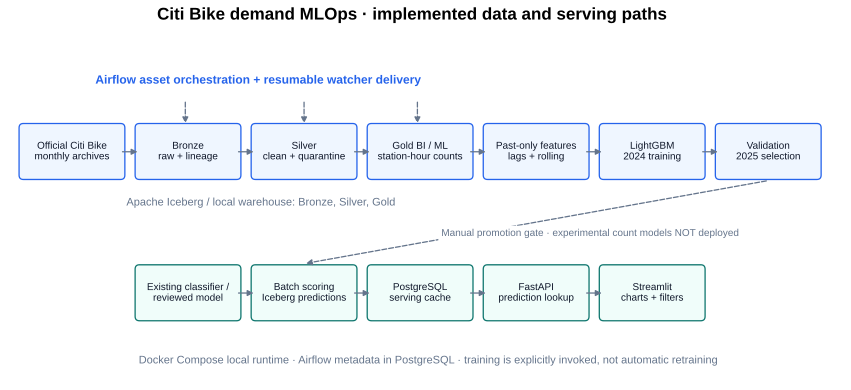
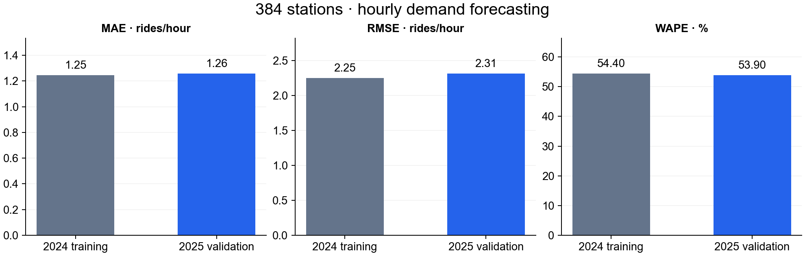
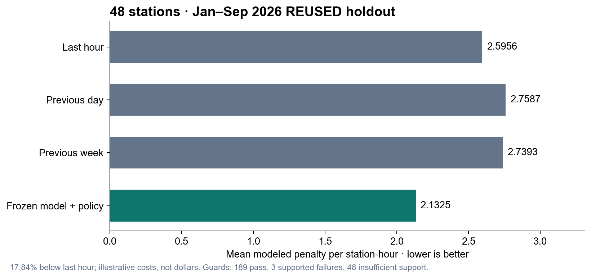
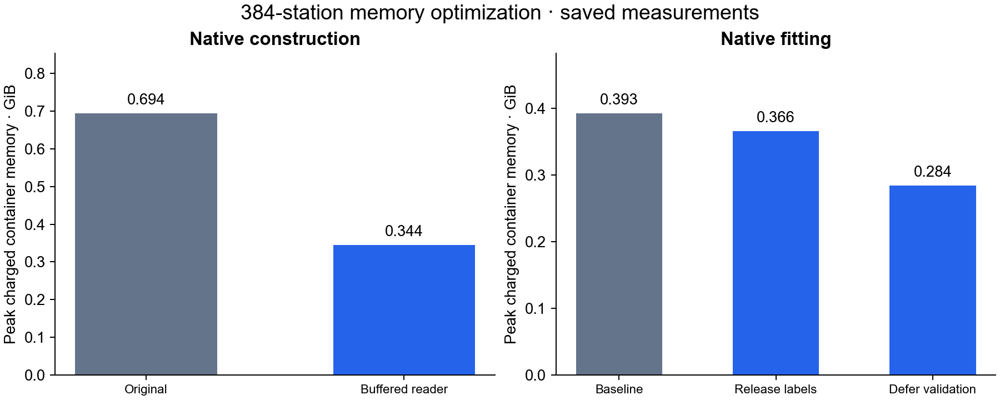
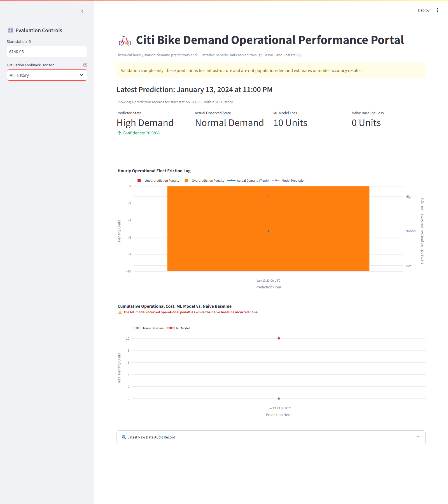
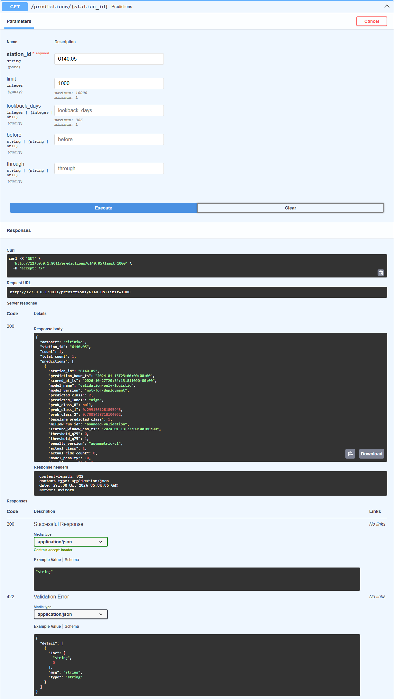

# Citi Bike Demand MLOps Pipeline

A local, reproducible lakehouse pipeline that transforms official NYC Citi Bike trip archives into validated station-hour observations, demand forecasts and an operational dashboard.

The project connects data engineering with two separate ML questions: **how accurately can hourly departures be forecast, and how should forecasts inform decisions when underprediction costs more than overprediction?** Recorded departures represent served demand, not unmet demand or available bike inventory.

**Status:** 33 months of ingestion and bounded end-to-end delivery are verified. The 384-station forecasting experiment is complete. A separate 48-station policy experiment has useful aggregate results but unresolved generalization guards. Full-network training across 1,898 stations is **paused after partial preparation**. No full-network model or production deployment is claimed.

## Verified results

| Scope | Verified achievement | Interpretation |
|---|---|---|
| Ingestion | **33 months**, January 2024–September 2026; **125,217,844 source records** (~125.2 million) | Official NYC archives; all monthly and three annual gates verified |
| Data quality | **125,092,464 accepted rides**, **125,380 quarantined records** | Accepted + quarantine reconciles to source |
| End-to-end delivery | Watcher → Airflow → Spark/Iceberg → batch scoring → PostgreSQL → FastAPI → Streamlit | Genuine 20,000-row January 2024 smoke demonstration, not model-quality evidence |
| 384-station forecast | **3,308,544 training rows**, **3,363,840 validation rows** | Full-year 2024 training and full-year 2025 validation |
| 384-station validation | **MAE 1.2577**, **RMSE 2.3138**, **WAPE 53.90%** | Ride-count forecasting errors, not classification accuracy |
| Separate 48-station policy | **17.84% lower modeled penalty** than last hour | January–September 2026 **reused holdout**, not independent validation or measured financial savings |

Figures are checked against retained experiment outputs. See [publication results and source hashes](docs/audit/publication_results.json) and the [verification report](docs/PUBLICATION_REVIEW.md). Large artifacts remain local and outside Git.

## Architecture



Airflow assets orchestrate Bronze, Silver and both Gold branches. A local filesystem watcher delivers manifests; it is not AWS Lambda. Training is explicitly invoked. **Experimental 48/384-station count models have not replaced the existing serving path.** Promotion is a separate decision. FastAPI reads persisted predictions rather than fitting or invoking LightGBM per request.

| Component | Technology and responsibility |
|---|---|
| Ingestion | Official ZIP/CSV archives, resumable downloads, SHA-256 manifests, watcher events |
| Processing/storage | PySpark 3.5.6, Java 17, Apache Iceberg 1.10.0 Spark runtime; PyIceberg reference checks |
| Orchestration | Airflow 3.2.2, asset events, retries, serialized Spark work, monthly checkpoints, annual gates |
| Modeling | NumPy/pandas, scikit-learn classifier, LightGBM 4.6.0 Poisson regression, disk-backed native training |
| Serving | Iceberg predictions, PostgreSQL cache, FastAPI, Streamlit and Plotly |
| Execution/testing | Docker Compose, Python 3.11 container runtime, pytest, Playwright, RAM/disk/OOM monitoring |

### Lakehouse contracts

| Layer | Table under the `citibike` Spark catalog | Contents |
|---|---|---|
| Bronze | `bronze.citibike_rides_raw` | Original strings plus source member, checksum and run lineage |
| Silver | `silver.citibike_rides` | Typed, accepted and deduplicated rides |
| Quarantine | `quarantine.citibike_rides` | Rejected rows with reasons and lineage |
| Gold BI | `gold.station_hourly_utilization` | Ride starts, duration, member/electric-bike activity |
| Gold ML | `gold.station_hourly_observations` | Dense station-hour departure counts |
| Predictions | `predictions.station_hourly_demand_predictions` | Classes, probabilities, decisions, versions and settled outcomes |

Gold ML contains **observations**, not a persisted feature mart. Features are reconstructed from history. Spark uses a Hadoop Iceberg catalog; PostgreSQL separately stores Airflow metadata and serving results. The bounded reference validator uses a SQLite SQL catalog and can use DuckDB; that path alone does not certify Spark integration.

## Data and quality controls

Sources are [Citi Bike System Data](https://citibikenyc.com/system-data) and its [official trip-history archive](https://s3.amazonaws.com/tripdata/index.html), subject to the source's data-use policy. Modern records contain ride ID, bicycle type, timestamps, station IDs/names, coordinates and membership type. NYC monthly archives are used, not Yellow Taxi Parquet or Jersey City `JC-` archives. Every CSV member in each ZIP is included; unsupported older schemas fail explicitly.

- Station IDs remain strings, preserving decimal-looking IDs and leading zeros.
- New York wall times become UTC. Ambiguous/nonexistent DST timestamps are quarantined. Calendar features use New York time; lags use elapsed UTC hours.
- Missing start stations, invalid timestamps/coordinates/categories and durations outside `(0, 86400]` seconds are rejected. Missing optional end stations are retained.
- Identical duplicate payloads collapse; conflicting ride IDs block publication. Candidate checks precede atomic month-partition replacement: a WAP-style workflow, not branch-based Iceberg WAP.
- Independent audits reconcile source, accepted, quarantine and Gold counts; check schemas, duplicate keys and finite features; and verify cross-month history.
- Checksums, source-version ordering, ledgers, locks, retries, checkpoints and annual gates support recovery and idempotent replay. A watcher event being accepted does **not** mean downstream work completed.

Zero filling applies only to stations observed in a complete source month. Missing station-months are not fabricated as active zero-demand history. Opening/closing dates and bike/dock availability are unavailable. Sampled inputs cannot populate production monthly tables.

## Forecasting and evaluation

The count target is departures during hour **t**, conditional on observations through **t−1**. Features are lags **1, 2, 24 and 168 hours**; shifted **6/24-hour rolling means and standard deviations**; cyclic hour/day features; weekend status; and a fixed cohort station code. Gaps restart the 168-hour warmup. Timestamp-based lag checks, streamed/reference parity and target-mutation tests protect against leakage.

| Period | Role |
|---|---|
| 2024 | Training, training-derived bins and demand thresholds |
| 2025 | Validation, model/policy selection and guard assessment |
| January–September 2026 | Previously inspected **reused-holdout diagnostics**; excluded from scaling experiments |

Earlier observed validation hours may supply later lag features, but do not fit parameters. This assumes timely observations: it is rolling hourly forecasting, not a fixed-origin year-long rollout. Cohort eligibility favors sufficient development history; results are not fleet-wide estimates.

### 384-station forecasting experiment

One deterministic Poisson model uses 100 boosting rounds, 15 leaves, learning rate 0.05, minimum leaf size 40, 63 bins, seed 42 and two threads. No expensive hyperparameter search was needed for this capacity experiment.

| Split | Station-hours | MAE, rides/hour | RMSE, rides/hour | WAPE |
|---|---:|---:|---:|---:|
| 2024 training | 3,308,544 | 1.2455 | 2.2479 | 54.40% |
| 2025 validation | 3,363,840 | **1.2577** | **2.3138** | **53.90%** |



MAE is mean absolute count error; RMSE emphasizes larger errors; WAPE is `sum(abs(prediction − actual)) / sum(actual)`, displayed as a percentage. None is an accuracy percentage. Zero-total slices have undefined WAPE. Original 384-stage preparation, construction, fit/checkpoint and export work totaled **1,085.298 seconds** on the measured machine, not a runtime guarantee. See [384-stage measurements](docs/NATIVE_CAPACITY_384.md).

### Separate 48-station operational-policy evaluation

Forecasts and operational actions are evaluated separately. Training-derived classes support an illustrative loss: underprediction costs **15 units per class gap**, overprediction **10 units per gap**. An empirical expected-cost policy and four seasonal last-hour fallbacks were frozen using development data. All **240 frozen 2025 guards passed** before reused-holdout evaluation.

| Method, identical 310,680 evaluation rows | Mean modeled penalty |
|---|---:|
| Last-hour baseline | 2.5956 |
| Previous-day baseline | 2.7587 |
| Previous-week baseline | 2.7393 |
| Frozen Poisson forecast + empirical policy + seasonal fallback | **2.1325** |



The **17.84%** aggregate reduction does not establish operational readiness: **189/240** 2026 guards pass, **three supported seasonal failures** remain, and **48 checks lack sufficient support**. Year-to-date station checks pass 47/48; the non-passing station lacks required support. Costs are assumed units, not dollars or verified rebalancing savings. This evaluation does not validate the separate 384-station model. See [frozen 48-station results](docs/COHORT48_2026.md) and [2025 seasonal fallback validation](docs/SEASONAL_FALLBACK.md).

### Memory-efficient training

The native pipeline streams station features into disk-backed matrices, retains canonical row keys/labels, constructs training-derived bins and exports predictions in bounded batches. Hashes verify checkpoints and forecasts. Buffered reads avoid large input copies; releasing Python label copies reduces fitting overhead. Fixed-budget deferred validation avoids a resident validation dataset during fitting and reconstructs validation curves afterward; it does **not** support early stopping.



These are charged container high-water measurements including charged file cache, not process RSS. Separate fresh benchmarks reduced construction from **0.694 to 0.344 GiB**, and fitting from **0.393 to 0.284 GiB** with deferred validation. Optimized models/checkpoints and forecasts match their corresponding baseline. Native binned training data remain resident: disk-backed input is **not** a fully external-memory learner. See [construction](docs/NATIVE_MEMORY_OPTIMIZATION.md), [fitting](docs/NATIVE_FIT_MEMORY.md) and [larger-host transfer](docs/TRAINING_HOST_TRANSFER.md).

## Working interfaces

These actual Chromium screenshots use the retained genuine January 2024 **20,000-row infrastructure sample** and its single saved smoke prediction. The visible sample warning is intentional. They demonstrate UI/API delivery, **not** 48/384-station forecasts or production deployment.





The default UI/API were reachable during review, but their prediction cache was empty. Temporary sample interfaces were used for the captures and stopped afterward. Airflow was stopped, so no new Airflow screenshot is claimed. A [mobile screenshot](docs/images/streamlit-genuine-2024-sample-mobile.png) is also available.

## Run locally

Use Python **3.11** to match Docker, Docker Compose v2 and Linux containers (Docker Desktop/WSL2 on Windows). Spark needs Java 17 and the matching Iceberg runtime; the image installs both. The full stack needs more RAM than an individual capped worker. An 8 GB laptop is not a guaranteed full-stack training environment.

### 1. Install and initialize

```bash
python -m venv .venv
# PowerShell: .\.venv\Scripts\Activate.ps1
# Linux/macOS: source .venv/bin/activate
python -m pip install -r requirements-dev.txt
python tools/init_local.py
docker compose config --quiet
```

Initialization creates missing ignored directories and local secrets while preserving existing settings. Never commit `.env`, generated authentication files or database dumps. Existing PostgreSQL volumes retain their passwords: editing environment variables does not rotate initialized databases. Review [publication/security notes](docs/PUBLICATION_REVIEW.md) before exposing anything beyond localhost.

### 2. Start infrastructure

```bash
docker compose up -d --build
docker compose ps
```

| Interface | Default local address |
|---|---|
| Airflow | `http://127.0.0.1:18080` |
| Streamlit | `http://127.0.0.1:8502` |
| FastAPI / OpenAPI | `http://127.0.0.1:8010/docs` |
| PostgreSQL serving cache | `127.0.0.1:5543` |
| Airflow metadata PostgreSQL | `127.0.0.1:5542` |
| Optional notebooks | `http://127.0.0.1:8889` |

Read the locally generated Airflow password file to sign in; it is excluded from Git. `/health` checks process liveness; `/ready` checks a usable prediction store. An empty store can be ready without containing station predictions.

### 3. Validate bounded genuine data first

This standalone reference check uses a bounded January 2024 sample; it does not establish model accuracy or run monthly production ingestion. Choose a **new** output directory. Reuse an existing sample rather than downloading again when available.

```bash
python -m jobs.download_raw_data --year 2024 --month 1 --sample-rows 20000 --max-download-mb 16 --output data/citibike/my-sample
python -m jobs.local_validate --source data/citibike/my-sample/202401-citibike-tripdata.sample.csv --year 2024 --month 1 --allow-sample --output artifacts/my-new-audit
```

For real Spark/Airflow/PostgreSQL/browser delivery, follow [Docker validation](docs/DOCKER_VALIDATION.md), [recovery](docs/RECOVERY_VALIDATION.md) and [complete-month orchestration](docs/FULL_MONTH_ORCHESTRATION.md). Sample and complete-month profiles have different contracts; sample zeros are not population features.

### 4. Deliver months, train and serve deliberately

1. Activate the Bronze, Silver and Gold asset DAGs; leave scoring paused until a reviewed compatible model/history exists.
2. Download a complete official archive and verified manifest into the configured incoming directory. The watcher emits an asset; Bronze, Silver and both Gold branches execute.
3. Wait for independent audit/checkpoint completion before the next month. Preserve annual gates and monitors; see [monthly ingestion](docs/MONTHLY_INGESTION.md) and [completed ingestion evidence](docs/CONTROLLED_INGESTION.md).
4. Train explicitly using 2024/2025 only. Native reproduction uses the [capacity-stage procedure](docs/NATIVE_CAPACITY.md), [384-stage configuration](docs/NATIVE_CAPACITY_384.md) and [memory options](docs/NATIVE_FIT_MEMORY.md). Do not invoke Linux worker modules directly in Windows or silently increase caps.
5. Review validation, guards, hashes and coverage before promotion. The separate existing classifier command is `python -m jobs.ml_train_pipeline --config config/local.yml --trials 2`, run **inside the Spark-enabled environment after Gold exists**; it is not the native Poisson experiment.
6. Existing batch scoring writes Iceberg predictions, PostgreSQL upserts station/hour records, and observed-outcome feedback settles costs. Replay must follow the model's training/information cutoff and have 168 hours of history. `python -m tools.backfill --start 2024-01-30T00:00:00Z --end 2024-01-30T03:00:00Z` is a dry run; adapt dates before adding `--execute`.

API routes include `/stations`, `/predictions/{station_id}` and `/predictions/{station_id}/{UTC-hour}`. Streamlit supports station selection, 7/10/14-day or complete-history filters, class timelines and penalty charts. Unknown stations/unavailable stores return explicit responses, not invented predictions.

Stop with `docker compose stop`; do not remove volumes to troubleshoot or overwrite model directories. Local datasets and experiment artifacts are intentionally absent from a clean clone; portable reports do not substitute for transferring the original artifacts.

## Tests and reproducibility

```bash
python -m pytest -q
python -m compileall -q jobs dags fastapi streamlit tools
# Regenerate publication plots from retained local summaries; no inference:
python -m tools.publication_assets
```

The latest publication checks are recorded in [PUBLICATION_REVIEW.md](docs/PUBLICATION_REVIEW.md). Tests cover source validation, version ordering, replay, features/leakage, resource admission, checkpoints, API and dashboard behavior. Unit tests do not certify the whole stack; Docker and real-browser checks have separate evidence. Plot generation requires the ignored original verification artifacts named in the generator; it neither reads raw test data nor rescores it.

Experiments retain cohorts, chronological splits, feature order, source/image/model hashes, row-key alignment, predictions, checkpoints, curves and memory/OOM records. The paused full-network runner resumes completed phases; an interrupted fit restarts from its native dataset rather than continuing mid-iteration. See [full-network preparation and recovery limits](docs/FULL_NETWORK_NATIVE_RUN.md).

## Repository guide

```text
dags/                 Airflow asset, scoring and validation DAGs
jobs/                 Ingestion, ETL, features, training and persistence
tools/                Audits, experiment runners, monitoring and reproduction
config/               Local and isolated resource/experiment profiles
fastapi/              Prediction-store API
streamlit/            Dashboard
tests/                Regression and bounded integration tests
docs/audit/           Portable verification reports
docs/images/          Diagrams, real screenshots and result plots
data/, models/, artifacts/, logs/   Local-only, Git-ignored state
```

Historical taxi notebooks/images remain local for provenance and are excluded from publication candidates. They are not Citi Bike results. A legacy `mlflow_run_id` field is a local run identifier; an MLflow server/registry is not integrated.

## Limitations and future work

- **Full-network training across 1,898 eligible stations:** paused after January–April 2024 raw preparation; no completed feature matrices or trained full-network model. This is a capacity/preparation limitation, not failed trained-model development.
- **Larger-memory infrastructure:** pass host admission and bounded benchmarks before scaling, preserving hard caps, leases, disk reserves and OOM safeguards. Raw-phase success does not prove full native fitting fits.
- **Independent prospective validation:** include realistic observation latency, station openings/closures, adequate seasonal coverage and fixed guards. Do not tune on the reused 2026 period.
- Resolve policy guard failures and sparse/inactive-station limitations without weakening frozen evaluation rules. Validate assumed costs with operational stakeholders.
- Consider **production deployment** only after model promotion review, access control, monitoring/alerting, security hardening, backup/recovery and independent quality gates. Local serving is not a production rollout.

## License and security

Project code is licensed under the [MIT License](LICENSE). Citi Bike trip data remains subject to its separate official data-use policy; the MIT license does not relicense that data or third-party dependencies.

Local credentials were rotated after a private verified backup. The original historical repository is retained privately; publish only the separately audited clean-history source repository. No secrets, database dumps, datasets or trained models belong in Git. See [credential remediation and publication scope](docs/SECURITY_REMEDIATION.md) for actual verification and remaining limitations.
