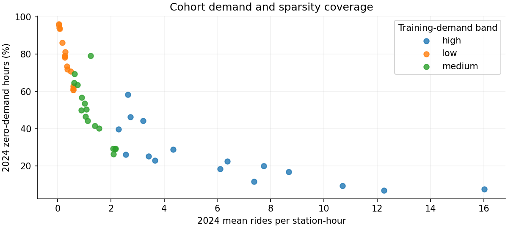
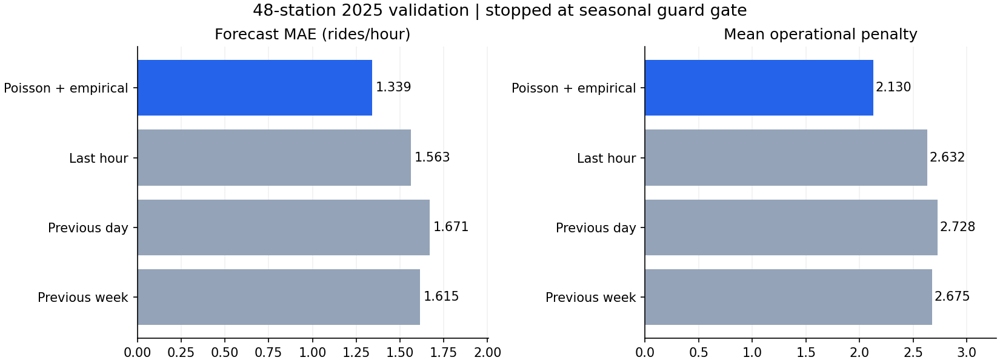

# Larger-cohort ML experiment ? October 28, 2026

**Stopped at the unchanged validation guard gate. No 2026 diagnostics were run, and nothing was deployed.** The bounded 48-station model improves aggregate 2025 forecast and operational metrics, but four seasonal checks fail across three stations. The requested stop rule was honored; stations were not removed and constraints were not relaxed.

**Validation-only follow-up:** the [existing seasonal fallback audit](SEASONAL_FALLBACK.md) resolves the four failures with 240/240 guards passing and unchanged count forecasts. The stopped global-policy run below remains preserved; the fallback is a separate overlay and 2026 remains unopened.

## Cohort design and coverage

**48 rather than 50 stations** gives equal allocation to 12 strata: three 2024 demand bands ? four within-band 2024 seasonal-variation quartiles, with four stations in each cell. Within each cell, evenly spaced training zero-demand ranks include sparse and less-sparse extremes. Selection is deterministic, not a random population sample.

- Observed stations in 2024/2025: **2,471**; eligible: **1,898**; selected: **48** (16 low-, 16 medium-, 16 high-demand).
- Eligibility uses only 2024/2025: all 12 months present in both years; at least 8,000 hours and 50 positive-demand hours per year; at least 500 hours and 10 positive hours per season. This excludes new/short-history or extremely unsupported stations rather than inventing history. No station was excluded using model error or 2026 availability.
- Selected 2024 mean demand spans **0.0523?16.0110 rides/hour**; zero-demand fractions span **6.94%?95.98%**.
- Training seasonal coefficient of variation spans **0.181?0.745**. Ten selected stations have q75 = 0, preserving a substantive zero-demand challenge.
- The eligible population spans 0.0523?18.6056 mean rides/hour; the chosen cohort is diverse but does not include every extreme or support a fleet-wide performance claim. Its full station IDs, training/calibration profiles and stratum membership are saved in `cohort.json` and `cohort_coverage.csv`.



## Training and leakage controls

The run used **413,568 complete-feature 2024 training rows** and **420,480 2025 validation rows**. Each station contributes 8,616 and 8,760 rows respectively. Training loses the initial 168-hour warmup; validation uses genuine past-year context.

- Same immutable Gold snapshot as the earlier pilot; only 2024/2025 partitions were read. The population scan covered 38,820,660 Gold observations, with a separate bounded extraction of the selected stations.
- Existing past-only lag/rolling features, New York calendar handling, gap resets and per-station mutation/oracle checks were reused. Target count at t is not an input. One-hour-ahead evaluation assumes prior actual counts are available; real observation latency and supply constraints remain unvalidated.
- A new LightGBM Poisson model was fitted with the previously fixed configuration: 100 trees, 15 leaves, learning rate 0.05, max bin 63, minimum child size 40, seed 42 and two threads. No HPO or validation refit.
- A new station-code map is explicitly trained for this cohort. The original 12-station model/artifacts remain intact; codes and predictions are not silently extrapolated to unseen stations.
- The same global empirical decision mechanism was calibrated on frozen-model **2024 predictions and labels only**: eight forecast-quantile bins per station, prior strength 20, expected-cost action selection and zero baseline shrinkage. It does not alter the count predictions. No decision hyperparameters were changed on this cohort.
- Actual q25/q75 classes are fitted on each station's 2024 complete-feature observations only. Cost matrix and underprediction/overprediction weights remain unchanged. Validation compares last-hour, 24-hour and 168-hour baselines at identical station-hours.

## Genuine 2025 validation metrics

| Model/baseline | MAE | RMSE | WAPE | Mean operational penalty |
|---|---:|---:|---:|---:|
| Poisson + global empirical decisions | 1.3395 | 2.5021 | 51.49% | 2.1298 |
| Last hour | 1.5631 | 3.2754 | 60.09% | 2.6316 |
| Previous day | 1.6706 | 3.6104 | 64.22% | 2.7280 |
| Previous week | 1.6154 | 3.4699 | 62.09% | 2.6748 |



Aggregate mean cost is **19.07% lower than last-hour actions**, and count MAE/RMSE/WAPE beat all three baselines. These gains do not override failed station-season guards. MAE/RMSE are rides per station-hour; WAPE is pooled absolute error / actual rides, not classification accuracy. Operational costs are project-defined ordinal cost units, not measured financial savings. Metrics should not be compared directly with the differently composed 12-station pilot.

## Frozen regression gate: failed

The runner asserts that imported constraints exactly match the previous `station-robustness-01/policy_lock.json`. It does not tune them. For each station and station-season, paired policy-minus-last-hour costs use New York calendar-week clusters and the same one-sided 95% Student-t bound. Required upper bound is ? **max(0.05, 2% of baseline mean cost)**. Annual support remains 2,000 hours/26 weeks/50 positive hours; seasonal support remains 500 hours/eight weeks/10 positive hours.

**236/240 pass: all 48 annual checks and 188/192 seasonal checks.** Every annual mean penalty is lower than the baseline; there are no annual point-estimate regressions. All failed cells satisfy the minimum-support rules; their failures are about the uncertainty bound, not missing training/calibration history.

| Station / season | Hours / week blocks | Positive hours | Model penalty | Last-hour penalty | Mean difference | Upper bound | Allowed bound |
|---|---:|---:|---:|---:|---:|---:|---:|
| 4440.02 / fall | 2,185 / 13 | 454 | 1.6384 | 1.6934 | -0.0549 | +0.0559 | 0.0500 |
| 4689.03 / fall | 2,185 / 13 | 1,765 | 3.7208 | 3.7529 | -0.0320 | +0.2652 | 0.0751 |
| 4945.06 / fall | 2,185 / 13 | 1,218 | 4.1465 | 4.0160 | +0.1304 | +0.4352 | 0.0803 |
| 4945.06 / summer | 2,208 / 14 | 1,198 | 4.0353 | 4.0761 | -0.0408 | +0.2176 | 0.0815 |

- `4945.06` fall is the **only seasonal observed-mean regression** among all 192 seasonal cells: +0.1304 units/hour (about 3.25% above the baseline). Its broad uncertainty interval does not establish a population-level degradation with certainty, but it fails non-inferiority under the frozen rule.
- The other three cells have better observed means but upper bounds above tolerance, so non-inferiority is **inconclusive**. `4440.02` fall narrowly misses; the tolerance was not rounded or relaxed to make it pass.
- `4440.02` is a medium-demand, high-seasonality station (2024 zero fraction 79.03%, seasonal CV 0.745). `4689.03` is medium-demand (26.37% zeros, CV 0.323). `4945.06` is in the low-demand band (61.68% zeros, CV 0.369). The failures span different sparsity profiles rather than a single zero-threshold edge case.
- The last-hour baseline is the unchanged reference. Guard bounds remain engineering screens, not multiplicity-adjusted simultaneous guarantees; weekly serial dependence and reuse of validation for future policy changes remain limitations.

## Stop behavior and 2026 status

Run status is **`stopped_validation_guards`**. The stopped experiment retains its model, calibrator, metrics and all failed checks for review. No fallback was fitted or activated to rescue this run, and no failing station was removed.

**2026 was not opened for model inference or diagnostic scoring.** There is no `raw/2026` extraction, approved `selection_lock.json`, or 48-station reused-holdout metric file. Therefore no 2026 forecast/penalty numbers are reported. Future evaluation would still be labelled reused-holdout diagnostics, not fresh independent validation.

The tool handles this as a controlled stop and records its decision in `metrics.json`; container exit code 0 is not approval to proceed. Downstream/manual execution must require `status == complete` and passed guard evidence, not merely a process exit code. There is no automatic deployment path.

## Runtime, memory and validation

- Model fit: **1.760 seconds**; empirical calibration/prediction: **0.789 seconds**; full run through the stop gate: **82.821 seconds**. Full time includes population scans, extraction, feature checks, training and validation, excluding container startup/imports and later report/test generation.
- Peak charged cgroup memory: **429,281,280 bytes (0.400 GiB)** under a 2 GiB hard cap. Process peak RSS: **528,949,248 bytes**. Two CPUs, no extra swap; zero memory-limit/OOM/OOM-kill events. These are experiment-container values, not the entire Docker stack.
- Bounded Parquet reads use 32,768-row batches, projected columns and station/year filtering. One file is read at a time; per-station raw/feature shards bound preprocessing memory. Iceberg snapshot planning is retained, and the reader refuses row-delete files rather than ignoring them.
- Live host-disk monitoring and the 10 GiB resource reserve were checked between files/stages; a 95%-of-memory-cap safe-stop flag protects phase transitions in addition to the hard Docker limit.
- Automated regression suite: **142 passed, two skipped**, with 17 dependency warnings. New tests cover balanced deterministic selection, low-support exclusions, test-year rejection, calibration-label-independent ranking and smaller supported populations. Existing guard tests remain unchanged. Host-only Airflow/PySpark checks remain skipped; actual bounded training ran in Docker.
- All prior experiment files and 33 monthly checkpoints passed hash preservation checks. The new run writes only its own artifact directory; existing datasets, trained models, checkpoints and production serving remain unchanged. No commits or pushes.

## Artifacts and reproduction

New ignored directory: `artifacts/cohort-48-01/`. It contains native/Joblib model files, the empirical policy, configuration, selection/coverage metadata, class thresholds, per-station engineered data and training tails, validation predictions/actions, station metrics, all 240 checks, four failed checks, CSV comparisons, source snapshots/hashes, progress events, memory samples and regression XML. The [portable summary](audit/cohort48.json) and plots are aggregated genuine outputs.

Reproduce this fixed experiment using a **new** container/output name. Do not remove old outputs or change guards to force completion:

```powershell
docker run --name citibike_cohort_48_02 --network none --cpus=2 --memory=2g --memory-swap=2g --entrypoint python --mount "type=bind,source=$($PWD.Path),target=/opt/airflow" --workdir /opt/airflow -e PYTHONPATH=/opt/airflow -e OMP_NUM_THREADS=2 -e OPENBLAS_NUM_THREADS=2 citibike-airflow-spark-iceberg:3.2.2-python3.11 -u -m tools.bounded_cohort_ml --output /opt/airflow/artifacts/cohort-48-02 --stations 48
```

Presentation regeneration and regression tests do not rerun the 48-station training experiment:

```powershell
.\.venv\Scripts\python.exe -m tools.report_cohort_ml
.\.venv\Scripts\python.exe -m pytest -q
```

## Recommended next action

The model is resource-feasible and promising in aggregate, but **not approved for 2026 scoring or deployment under the requested guards**. Stop here. A next bounded, validation-only experiment could apply the already-implemented station-season fallback mechanism to the failed cells, recheck all annual/seasonal guards, then freeze any approved policy before opening 2026. Keep all 48 stations and the original tolerances; no expensive retraining or HPO is needed to investigate that option. This follow-up was **not executed** in the current run.
