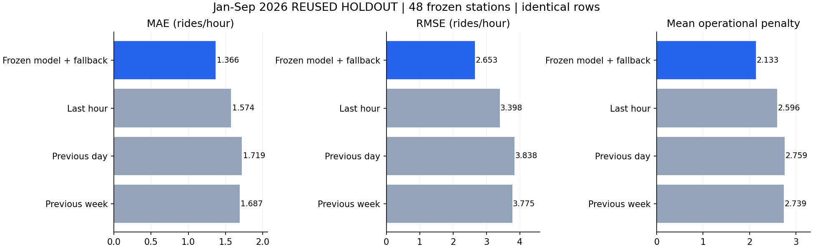
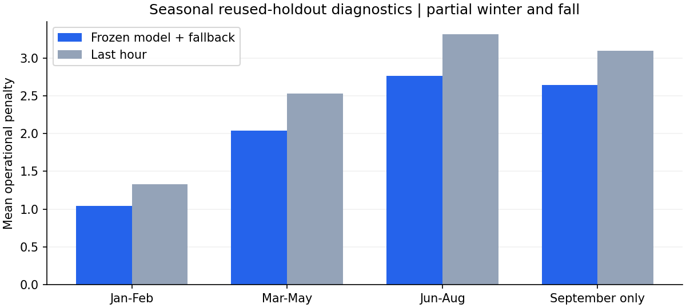

# Frozen 48-station January?September 2026 evaluation

**REUSED HOLDOUT ? not fresh independent validation.** One frozen, bounded scoring pass completed. Aggregate forecast errors and operational cost beat the three baselines, but the frozen guards **do not all pass**. Status: `complete_with_guard_failures`. No model refitting, recalibration, rule adjustment, station removal, deployment, commit or push followed these results.

## Exact freeze before opening 2026

The validated four-cell overlay and 48-station source artifacts were checked against the saved 2025 approval. An immutable copy of the cohort, station-code map, Joblib/native LightGBM model, empirical probability policy, training thresholds, cohort configuration, fallback specification, original validation lock and 48 training-history tails was created under `frozen/`. Core feature/decision/guard source files were also copied and hashed. The cost matrix, feature order, guard configuration, dataset snapshot and dependency versions were persisted in the evaluation lock before any 2026 Parquet batches were read.

| Frozen component | SHA-256 |
|---|---|
| Evaluation lock | `993efc74044ae029a4e4ec87ba5dae19e5a1431d0cbac4ba4cb53fa656581bf3` |
| Cohort | `6206e6701bef48db22b0e6ccaa26306e267910be6d6b83b896d0df446cc09f38` |
| Count model (Joblib) | `976d44dca39dc92367ec99d8a8f156e27a1b0eeb37e23a1533ad5994e3eaea99` |
| Empirical policy | `b01d1a67d48b5548b035acfc791328fd3f5643b0cb12c89cdc34a92341e0ecc1` |
| Four fallback rules | `dd82206fda62e897de517e6dd4ad757de3f16cb4ab219ba1e12787f3fb90d7a9` |
| Training class thresholds | `a97b598fc9af7d83aa50d455743cba77ad69b986c7d25b28126c793c66872a61` |

The complete file hashes and guard payload are in `evaluation_lock.json` and `evaluation_lock_sha256.json`. After scoring, every frozen file, the lock itself, all prior cohort/fallback artifacts and all 33 ingestion checkpoints were checked unchanged. There was exactly **one LightGBM `predict` call** and no fit/calibration/policy-selection operation.

## Evaluation rows and temporal protocol

All **48 stations** remain in the cohort. The reader streamed **14,918,566** 2026 Gold observations and selected **310,848** genuine cohort rows. After gap-aware lag eligibility, **310,680 identical station-hour rows** were used for the model and every baseline; each has the same **813,323 actual rides** denominator.

- Calendar period: January 1 through September 30, 2026 in America/New_York. Source-year/month filters and local timestamp checks both fence the period.
- Frozen 2025 final 168-hour tails provide context for January. Features and baselines are rolling one-hour-ahead, using actual past demand only; earlier observed 2026 counts may feed later lags but never parameter fitting. This is not a single fixed-origin nine-month forecast and assumes zero observation latency.
- All regular stations contribute 6,551 complete-feature hours. `3931.09` has source observations only through May: **3,623** scored hours. `6190.03` has no February station-month observations: **5,879** raw hours, with **168** March warmup hours excluded after the gap, leaving **5,711** scored hours.
- Missing station-months were **not filled with invented zero demand**. All 48 station IDs are retained in coverage and guard reporting, including explicit unsupported/empty station-season cells. This follows the existing Gold active-month convention; absent observations do not establish station closure or its cause.
- Frozen last-hour actions replace empirical actions only for `4440.02` fall, `4689.03` fall, `4945.06` fall and `4945.06` summer. No new rule is added from this period.

## Aggregate reused-holdout metrics

| Model / baseline | MAE | RMSE | WAPE | Mean operational penalty |
|---|---:|---:|---:|---:|
| Frozen Poisson + empirical + seasonal fallback | 1.3661 | 2.6528 | 52.19% | 2.1325 |
| Last hour | 1.5739 | 3.3979 | 60.12% | 2.5956 |
| Previous day (24h) | 1.7190 | 3.8381 | 65.67% | 2.7587 |
| Previous week (168h) | 1.6873 | 3.7751 | 64.45% | 2.7393 |



Model mean cost is **17.84% lower than last-hour actions**. Total costs are 662,535 model units versus 806,395 last-hour, 857,060 previous-day and 851,045 previous-week units. MAE/RMSE are rides per station-hour; WAPE is sum absolute count errors / sum actual rides, not classification accuracy. The operational matrix remains `[[0,10,20],[15,0,10],[30,15,0]]` with 2024 per-station q25/q75 classes; cost units are project-defined, not measured financial savings. Aggregate gains do not override failed station guards.

## Seasonal performance

| Observed season | Rows | Model MAE | Model RMSE | Model WAPE | Model mean penalty | Last-hour mean penalty |
|---|---:|---:|---:|---:|---:|---:|
| winter | 67,296 | 0.8413 | 1.4780 | 79.16% | 1.0394 | 1.3314 |
| spring | 105,768 | 1.3477 | 2.6052 | 53.74% | 2.0426 | 2.5317 |
| summer | 103,776 | 1.6592 | 3.1376 | 47.37% | 2.7667 | 3.3164 |
| fall | 33,840 | 1.5690 | 2.9768 | 46.98% | 2.6429 | 3.0990 |

Winter includes January/February only; fall includes September only. High relative error during low-demand winter is not masked. Missing station-months mean per-season row counts differ from a fully active 48-station grid. All models use identical observed eligible rows within each season.



## Frozen guard results and uncertainty

The unchanged guard computes paired policy-minus-last-hour hourly costs with New York calendar-week cluster-robust standard errors and one-sided 95% Student-t upper bounds. Required bound remains ? `max(0.05, 2% of baseline mean penalty)`; annual support remains 2,000 hours/26 weeks/50 positive hours; seasonal support remains 500 hours/eight weeks/10 positive hours. The existing baseline-identity exception is retained.

?Annual? here means applying that annual rule to **available January?September year-to-date rows**, not claiming complete-calendar-year coverage. The guard uses the same formulas and support requirements as 2025; none was weakened to fit the shorter period.

| Guard scope | Pass | Supported failures | Insufficient-support failures | Total |
|---|---:|---:|---:|---:|
| Year-to-date station (?annual? rule) | 47 | 0 | 1 | 48 |
| Station-season | 142 | 3 | 47 | 192 |
| **All guards** | **189** | **3** | **48** | **240** |

The 189 passes comprise **185 bound passes and four baseline-identical cells**. Three baseline-identical cells are September fallback cells: they pass the frozen identity rule despite short seasonal coverage because their incremental action cost is exactly zero. This is baseline equivalence, not a learned-benefit or full-fall coverage claim.

### Adequately supported failures

| Station / season | Hours / weeks | Model / last-hour penalty | Mean difference | Upper bound | Allowed bound | Interpretation |
|---|---:|---:|---:|---:|---|
| 4804.02 / winter | 1,416 / 9 | 1.0311 / 1.1123 | -0.0812 | +0.0702 | 0.0500 | Better mean; uncertainty bound fails |
| 5436.11 / spring | 2,207 / 14 | 2.9135 / 3.3870 | -0.4735 | +0.1166 | 0.0677 | Better mean; uncertainty bound fails |
| 6585.11 / summer | 2,208 / 14 | 4.4769 / 4.3591 | +0.1178 | +0.4136 | 0.0872 | Observed higher mean; bound fails |

`6585.11` summer has an **observed mean regression of +0.1178 units/hour**, about 2.70% above last-hour cost. The other two supported failures have lower means but insufficient evidence under the frozen upper-bound criterion. These are point estimates and engineering non-inferiority screens, not proof of population-level harm or simultaneous multiplicity-adjusted guarantees.

### Coverage failures and overlapping observed regressions

- **45 fall cells** fail support: 44 have September-only coverage (five week blocks rather than eight), and `3931.09` has no fall observations. The three frozen fall fallback cells pass only by action identity.
- `3931.09` year-to-date has 3,623 hours but only **22 week blocks**, below the annual minimum 26; its summer has **zero observations**. Both remain unsupported rather than dropped.
- `6190.03` winter has **744 hours and five week blocks**, reflecting the absent February station-month. It has an observed mean increase **+0.1142** (0.4167 versus 0.3024), but it is classified as insufficient support, not concealed or promoted to a supported non-inferiority claim.
- `6585.11` September also has an observed increase **+0.5000** (4.2500 versus 3.7500), upper bound +0.9205, but only five week blocks. It remains an unsupported fall result. Thus ?48 insufficient-support failures? does not imply that their observed costs all improve.
- All 48 available year-to-date station mean penalties are below last-hour means. One of those stations still fails the support requirement. No rule, station membership, threshold, probability or fallback was changed after inspecting any diagnostic.

Complete outcomes?including unsupported empty cells, observed positive-difference flags, upper bounds and fixed margins?are in `all_240_guard_outcomes.csv`, `guard_outcomes.json`, `failed_guards.json` and the portable [all-240 audit](audit/cohort48_2026.json).

## All-station year-to-date results

Full model/baseline metrics and season-by-station slices are saved as CSV/JSON. The table below retains every cohort station. ?Unsupported? is not a passing guard.

| Station | Rows | Model MAE | Model WAPE | Model penalty | Last-hour penalty | YTD guard |
|---|---:|---:|---:|---:|---:|---|
| 2971.02 | 6,551 | 0.4236 | 437.65% | 1.2571 | 1.7631 | Pass |
| 3019.02 | 6,551 | 0.4014 | 608.70% | 0.8174 | 1.2059 | Pass |
| 3164.04 | 6,551 | 0.3950 | 628.09% | 0.8701 | 1.3128 | Pass |
| 3303.03 | 6,551 | 0.9118 | 92.97% | 2.5943 | 2.8698 | Pass |
| 3588.01 | 6,551 | 0.9558 | 87.66% | 2.2394 | 2.5225 | Pass |
| 3651.04 | 6,551 | 2.9569 | 36.73% | 2.7721 | 3.4041 | Pass |
| 3731.11 | 6,551 | 1.8080 | 45.41% | 1.9699 | 2.5988 | Pass |
| 3931.09 | 3,623 | 0.5417 | 206.60% | 0.8032 | 1.0420 | Unsupported |
| 4010.15 | 6,551 | 2.2496 | 47.68% | 1.7280 | 2.0379 | Pass |
| 4025.02 | 6,551 | 1.5371 | 56.67% | 2.4042 | 2.9789 | Pass |
| 4440.02 | 6,551 | 1.0563 | 96.65% | 1.6265 | 1.8623 | Pass |
| 4519.02 | 6,551 | 1.4706 | 57.28% | 2.0798 | 2.4515 | Pass |
| 4672.01 | 6,551 | 1.0071 | 78.14% | 2.4088 | 2.7706 | Pass |
| 4689.03 | 6,551 | 1.4032 | 61.89% | 2.9041 | 3.1583 | Pass |
| 4756.04 | 6,551 | 1.6996 | 61.40% | 1.5753 | 1.7974 | Pass |
| 4768.02 | 6,551 | 1.1239 | 67.39% | 2.3813 | 2.9232 | Pass |
| 4792.03 | 6,551 | 1.3422 | 58.15% | 2.6172 | 3.1140 | Pass |
| 4804.02 | 6,551 | 1.6493 | 64.55% | 1.4181 | 1.6753 | Pass |
| 4945.06 | 6,551 | 0.7277 | 107.23% | 2.7110 | 2.9713 | Pass |
| 5422.09 | 6,551 | 2.7820 | 40.32% | 3.1346 | 3.8620 | Pass |
| 5436.11 | 6,551 | 1.4771 | 62.66% | 3.5888 | 4.5352 | Pass |
| 5579.04 | 6,551 | 0.6018 | 152.44% | 1.1380 | 1.6181 | Pass |
| 5763.03 | 6,551 | 4.1538 | 32.09% | 2.8446 | 3.6750 | Pass |
| 5779.10 | 6,551 | 2.9507 | 36.86% | 3.5506 | 4.5451 | Pass |
| 5779.11 | 6,551 | 3.4483 | 31.48% | 2.4767 | 3.2003 | Pass |
| 5838.09 | 6,551 | 2.8209 | 39.31% | 3.1842 | 3.8490 | Pass |
| 6028.01 | 6,551 | 0.5156 | 219.89% | 2.8026 | 3.3392 | Pass |
| 6128.04 | 6,551 | 1.2119 | 71.94% | 2.2653 | 2.7133 | Pass |
| 6149.02 | 6,551 | 0.5222 | 198.67% | 0.6045 | 0.9235 | Pass |
| 6190.03 | 5,711 | 1.2118 | 65.39% | 2.2947 | 2.5784 | Pass |
| 6361.03 | 6,551 | 0.8597 | 95.55% | 2.5683 | 3.0072 | Pass |
| 6395.01 | 6,551 | 0.8687 | 93.27% | 1.4914 | 1.6906 | Pass |
| 6441.02 | 6,551 | 1.6740 | 65.24% | 2.1913 | 2.4485 | Pass |
| 6450.05 | 6,551 | 4.5148 | 36.73% | 2.5523 | 3.4598 | Pass |
| 6464.09 | 6,551 | 2.7745 | 36.21% | 2.6729 | 3.7002 | Pass |
| 6585.11 | 6,551 | 0.7504 | 105.49% | 2.6584 | 2.7935 | Pass |
| 6594.02 | 6,551 | 0.7282 | 116.47% | 2.2623 | 2.7347 | Pass |
| 6700.14 | 6,551 | 1.6644 | 58.75% | 1.3311 | 1.6448 | Pass |
| 6869.10 | 6,551 | 0.4581 | 337.16% | 1.7104 | 2.3584 | Pass |
| 7793.02 | 6,551 | 0.5778 | 175.64% | 1.0502 | 1.4196 | Pass |
| 7932.10 | 6,551 | 0.9051 | 84.60% | 2.1111 | 2.4309 | Pass |
| 7979.17 | 6,551 | 0.7555 | 104.44% | 2.5836 | 3.0171 | Pass |
| 8008.03 | 6,551 | 0.6455 | 139.66% | 1.5524 | 2.0531 | Pass |
| 8205.05 | 6,551 | 0.7026 | 141.02% | 1.1968 | 1.4273 | Pass |
| 8472.06 | 6,551 | 0.5114 | 238.27% | 2.5347 | 2.9400 | Pass |
| 8559.04 | 6,551 | 0.3864 | 795.94% | 0.6251 | 0.9770 | Pass |
| 8738.01 | 6,551 | 0.5074 | 233.24% | 2.0569 | 2.5172 | Pass |
| 8815.01 | 6,551 | 0.5454 | 177.93% | 3.5766 | 3.9727 | Pass |

## Runtime, resources and tests

- Source extraction: **12.210 seconds**. Exactly one model prediction call: **0.327 seconds** for 310,680 rows. Frozen action conversion, including last-hour action construction: **0.708 seconds**.
- Full frozen extraction/features/scoring/metrics/guard run: **40.226 seconds**. Container startup/imports and subsequent test/plot generation are excluded; this is not training time.
- Peak charged cgroup memory: **374,128,640 bytes (0.348 GiB)** under the 2 GiB hard cap. Peak process RSS: **471,633,920 bytes**. Two CPUs, no extra swap, zero memory-limit/OOM/OOM-kill events. These are experiment-container figures, not total Docker-stack memory.
- Reads are limited to projected 32,768-row batches, one Parquet file at a time, with year/month/station filtering. Iceberg snapshot planning is used and row-delete files are refused rather than silently ignored. Host disk reserves and memory headroom checks remain active.
- Automated tests: **148 passed, two skipped**, with 17 dependency warnings. New regressions cover supported mean regressions versus uncertainty failures, short-season classification, frozen baseline identity and explicit reporting of missing station-season coverage. Existing feature-causality, fallback locality, support and cost tests pass. Host-only Airflow/PySpark checks remain skipped; actual inference ran in Docker.

## Reproducible artifacts without another scoring pass

New Git-ignored directory: **`artifacts/cohort-48-2026-01/`**. It retains the frozen input copies, complete evaluation lock and hash, model/policy/source hashes, source snapshot reference, 2025 context tails, one-pass predictions/actions, coverage and feature audits, aggregate/station/season metrics, all 240 guard results, failure list, CSV reports, progress events, memory samples and regression XML.

The executed command is recorded below for provenance. It is not an instruction to rerun scoring during this task or to use repeated evaluations for selection. Existing output directories are refused.

```powershell
docker run -d --name citibike_cohort_48_2026_01 --network none --cpus=2 --memory=2g --memory-swap=2g --entrypoint python --mount "type=bind,source=$($PWD.Path),target=/opt/airflow" --workdir /opt/airflow -e PYTHONPATH=/opt/airflow -e OMP_NUM_THREADS=2 -e OPENBLAS_NUM_THREADS=2 citibike-airflow-spark-iceberg:3.2.2-python3.11 -u -m tools.evaluate_cohort_2026 --output /opt/airflow/artifacts/cohort-48-2026-01
```

The read-only report tool uses saved metrics only and never predicts, fits or selects a policy:

```powershell
.\.venv\Scripts\python.exe -m tools.report_cohort_2026
.\.venv\Scripts\python.exe -m pytest -q
```

## Conclusion

The frozen configuration improves the aggregate count forecast and asymmetric cost relative to all three baselines on this **reused holdout**, but does **not** satisfy every frozen robustness guard. Retain all failures and coverage limitations. No new fallback is added for `4804.02`, `5436.11`, `6585.11` or any unsupported cell. The model, empirical calibration and four validated fallback cells remain exactly as frozen.

Production serving is unchanged and no deployment is authorized. Any later development must use separately justified development data and preserve this diagnostic record; it must not tune directly to these 2026 outcomes. No source dataset, checkpoint or prior experiment was overwritten, and no commit or push was made.
