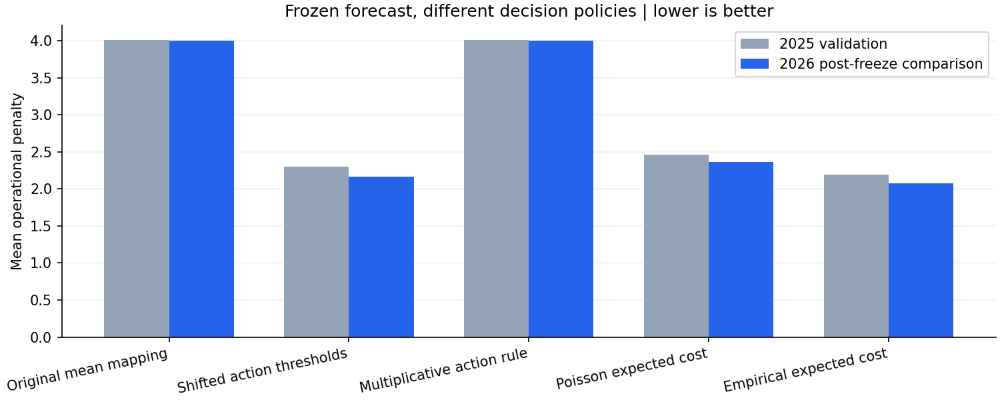
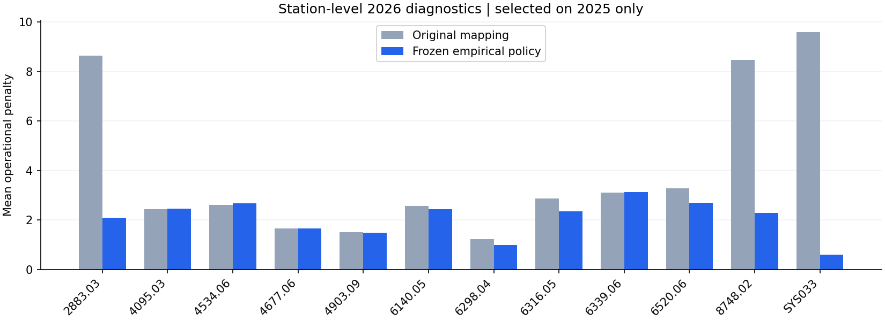

# Cost-sensitive decision-policy evaluation ? October 28, 2026

**The frozen empirical expected-cost policy improves the pilot operational penalty while preserving the count forecast exactly.** It was selected using 2025 only. Production serving models remain unchanged.

**Holdout limitation:** January?September 2026 was already inspected in the earlier count-model pilot. It cannot truthfully be called untouched again. This experiment did not use 2026 for candidate fitting, calibration, ranking or adjustment. Policy selection was persisted before opening the prior test-prediction artifact, and the fixed family representatives were compared in one subsequent pass. The reported comparison is reuse of a previously inspected holdout, not a fresh independent test.

**Robustness follow-up:** the [station/season validation](STATION_ROBUSTNESS.md) retained the global policy: all 60 prespecified validation guards passed, while baseline shrinkage increased cost. The follow-up separately records reused-holdout seasonal uncertainty; serving remains unchanged.

## Audit: targets, actions and asymmetric costs

- The count forecast remains the exact saved LightGBM Poisson model from `artifacts/ml-readiness-01/`. It was loaded, not refitted. The native model, Joblib model, original metrics/configuration/predictions and all other prior experiment files were hashed and verified unchanged, along with all 33 monthly checkpoint files.
- Actual Low/Normal/High classes remain defined by each station's **2024 complete-feature q25/q75 thresholds**. Low is count < q25, Normal is q25 through q75 inclusive, and High is count > q75. Neither quantiles nor actual classes were recalculated using validation/test data.
- Cost matrix rows are actual classes and columns are actions: `[[0,10,20],[15,0,10],[30,15,0]]`. Underprediction costs 15 per ordinal tier and overprediction 10. `p @ COST_MATRIX`, followed by argmin over columns, has the correct orientation. These are project cost units, not measured dollars or proven rebalancing savings.
- At `SYS033`, `8748.02`, and `2883.03`, both training quantiles are zero. Low is then an absent actual class; actual zero is Normal and any positive count is High. The old conversion classified every positive continuous Poisson mean as High, even if a zero outcome was probable. This is a mismatch between a conditional mean and a class action, not count-model artifact corruption.
- Rounded values, shifted action cutoffs and scaled decision scores must not be substituted for the forecast. The implementation now makes the distinction explicit: each policy returns a separate class action; the count vector is never modified.

## Bounded development protocol

The same **12 stations**, **102,503** training rows and **105,120** validation rows were reconstructed from the original immutable Gold snapshot. Only 2024/2025 Gold partitions were scanned. Past-only lags, gaps, local-calendar boundaries and the original station-code map were reused. Recomputed 2025 forecast metrics matched the original pilot at 1e-12 relative tolerance.

The candidate plan was fixed before evaluation and contained **41 cheap policies**, with no count-model training or expensive search:

| Family | Candidate configuration | Fitting/selection data |
|---|---|---|
| Original mapping | Existing q25/q75 cutoffs applied directly to count mean | Frozen reference |
| Calibrated action thresholds | 30 combinations: Low offset ?0.5/0/0.25/0.5/1/2; High offset 0/0.25/0.5/1/2. Nonnegative ordered action cutoffs | 2025 selects offsets; actual thresholds unchanged |
| Multiplicative/asymmetric action score | Mean ? 0.5/0.75/1/1.25/1.5, then original action cutoffs | 2025 selects factor; heuristic, not a probability model |
| Poisson expected-cost minimization | Class probabilities from Poisson CDF; distribution scales 0.5/1/1.5 | 2025 selects distribution scale |
| Empirical expected-cost minimization | 8 or 16 within-station forecast-quantile bins, class frequency estimates shrunk toward the station prior with strength 20 | Edges/probabilities/priors fitted on 2024; bin count selected on 2025 |

For Poisson probabilities, integer support is handled explicitly: P(Low) = CDF(ceil(q25)?1); P(Normal) = CDF(floor(q75)) ? P(Low); P(High) = 1 ? CDF(floor(q75)). This matters for fractional quantiles. Empirical probabilities use actual class frequencies, avoiding a strict Poisson dispersion assumption.

Empirical calibration uses frozen-model **in-sample 2024 predictions**, which can be optimistic; its 2025 evaluation is out-of-sample. It does not use 2025 labels to fit bin frequencies. Both empirical candidates share fixed prior strength 20. No unseen-station fallback is inferred: the policy supports only the known pilot cohort and rejects unknown stations.

The declared selection objective was **lowest pooled 2025 mean operational penalty**, with deterministic policy-name tie-breaking. The chosen policy is `empirical_expected_cost_8`. A representative winner from each family and the overall winner were frozen in `policy_lock.json`; there was no station-specific post-test override.

## Actual policy and baseline comparisons

All class-policy rows below use exactly the same count forecasts, and therefore have identical count error. Baselines retain their original count forecasts and class conversion. MAE/RMSE are rides per station-hour. WAPE is sum absolute count error divided by sum actual rides, shown as a percentage; it is not classification accuracy.

| Policy/baseline | 2025 mean penalty | 2026 mean penalty | 2026 MAE | 2026 RMSE | 2026 WAPE |
|---|---:|---:|---:|---:|---:|
| Original continuous-mean mapping | 4.0081 | 4.0003 | 1.4465 | 2.9773 | 43.26% |
| Calibrated action cutoffs (q25, q75+1) | 2.3014 | 2.1644 | 1.4465 | 2.9773 | 43.26% |
| Multiplicative rule (selected factor 1) | 4.0081 | 4.0003 | 1.4465 | 2.9773 | 43.26% |
| Poisson expected-cost rule (scale 1) | 2.4633 | 2.3587 | 1.4465 | 2.9773 | 43.26% |
| Empirical expected-cost rule (8 bins) | 2.1903 | 2.0742 | 1.4465 | 2.9773 | 43.26% |
| Baseline: last_hour | 2.7074 | 2.5614 | 1.7405 | 4.0513 | 52.06% |
| Baseline: previous_day | 2.7243 | 2.5924 | 1.8043 | 4.3278 | 53.97% |
| Baseline: previous_week | 2.6400 | 2.5845 | 1.7537 | 4.1300 | 52.45% |
| Baseline: training_weekly_mean | 3.6336 | 3.8036 | 1.7880 | 4.0414 | 53.48% |



Validation penalty fell **45.35%**, from 4.0081 to 2.1903. In the previously inspected test period, it fell **48.15%**, from 4.0003 to 2.0742; total cost fell from 314,470 to **163,055** units. This is **19.02% below the last-hour baseline** of 2.5614. The forecast still has MAE **1.4465**, RMSE **2.9773** and WAPE **43.26%**.

The simple shifted action threshold was a strong alternative, while multiplying the mean did not improve validation decisions: factor 1 won that family. Poisson expected-cost minimization helped, but empirical probabilities yielded the lowest validation cost. These are decision-policy comparisons, not evidence that the count forecaster itself improved.

## Sparse stations and station-level diagnostics

Across actual zero-demand test hours, the High-action rate fell from **47.07% to 1.43%**, and mean zero-hour penalty fell from **4.8207 to 0.3191**. The same behavior was already evident in validation (High-action rate 48.19% to 2.48%). The underlying positive count means were not zeroed or altered.

| Station | Original penalty | Frozen policy penalty | Change | Last-hour baseline |
|---|---:|---:|---:|---:|
| 2883.03 | 8.6521 | 2.0920 | -6.5601 | 2.5683 |
| 4095.03 | 2.4408 | 2.4691 | +0.0282 | 2.7858 |
| 4534.06 | 2.6225 | 2.6713 | +0.0488 | 3.1049 |
| 4677.06 | 1.6555 | 1.6578 | +0.0023 | 2.2439 |
| 4903.09 | 1.5013 | 1.4990 | -0.0023 | 1.7402 |
| 6140.05 | 2.5630 | 2.4309 | -0.1320 | 3.2575 |
| 6298.04 | 1.2220 | 0.9823 | -0.2397 | 1.4234 |
| 6316.05 | 2.8751 | 2.3615 | -0.5137 | 2.6256 |
| 6339.06 | 3.1102 | 3.1255 | +0.0153 | 4.0666 |
| 6520.06 | 3.2919 | 2.7042 | -0.5877 | 3.0209 |
| 8748.02 | 8.4705 | 2.2943 | -6.1762 | 3.0110 |
| SYS033 | 9.5985 | 0.6022 | -8.9963 | 0.8892 |



**Eight of 12 stations improve over the original mapping; four regress slightly.** The largest regression is about **0.0488** mean cost units at `4534.06`. All 12 have lower cost than the last-hour baseline in this diagnostic. No policy was changed in response to these test slices. The complete validation/test station MAE, RMSE, WAPE, penalties, zero-hour diagnostics and confusion matrices are saved locally.

## Runtime, resource use and preservation

- Empirical calibration: **0.115 seconds**; candidate validation/ranking: **4.186 seconds**.
- Applying the five frozen policy representatives and computing test aggregate/station metrics: **0.756 seconds** for **78,612** rows. This timing includes metrics; it is not pure per-action latency.
- Full pipeline: **19.598 seconds**, excluding container startup/imports, subsequent plotting and regression tests.
- Peak charged cgroup memory: **1,467,019,264 bytes (1.366 GiB)**; process peak RSS: **1,443,991,552 bytes**. Two CPUs, 2 GiB hard memory limit, zero additional swap. Limit/OOM/OOM-kill events: **zero**. This is experiment-container memory, not the whole Docker stack.
- Original experiment files and all ingestion checkpoints passed before/after SHA-256 checks. The test count-vector SHA-256 was unchanged, and every frozen policy reproduced the original count metrics at 1e-12 tolerance. There were no source table writes, model refits, production-model exports, commits or pushes.

## Artifacts and reproducibility

New Git-ignored run: `artifacts/ml-decisions-01/`. It contains `selected_policy.json`, the complete `policy_lock.json`, all candidate validation metrics, validation/test station metrics, confusion matrices, CSV comparisons, separate test actions/unchanged counts, configuration, progress events, memory samples, source snapshots/hashes, original-input hash manifest and regression-test XML. Original `artifacts/ml-readiness-01/` remains unchanged. The [portable summary](audit/decision_policies.json) contains genuine aggregated outputs only.

Load `selected_policy.json` to obtain the frozen policy, verify its model/target-threshold hashes, and pass the original count vector plus the known station IDs to `jobs.decision_policies.actions`. It returns actions 0/1/2 and does not need actual demand labels for inference. Keep the count forecast and decision action as separate outputs. This has not been connected to production serving.

Reproduce with the existing local image and immutable source snapshot, using a new output/container name to avoid overwriting this run:

```powershell
docker run --name citibike_ml_decisions_02 --network none --cpus=2 --memory=2g --memory-swap=2g --entrypoint python --mount "type=bind,source=$($PWD.Path),target=/opt/airflow" --workdir /opt/airflow -e PYTHONPATH=/opt/airflow -e OMP_NUM_THREADS=2 -e OPENBLAS_NUM_THREADS=2 citibike-airflow-spark-iceberg:3.2.2-python3.11 -u -m tools.bounded_decision_policies --output /opt/airflow/artifacts/ml-decisions-02
```

This replays a fixed comparison; do not use repeated 2026 evaluations to tune policies. To regenerate presentation only, without fitting or rescoring:

```powershell
.\.venv\Scripts\python.exe -m tools.report_decision_policies
.\.venv\Scripts\python.exe -m pytest -q
```

Automated validation: **133 passed, 2 skipped**, 17 dependency warnings. The two host-only Airflow/PySpark checks remain skipped. New policy tests cover asymmetric matrix orientation, zero thresholds, fractional-count boundaries, forecast/target immutability, empirical serialization, no dependence on inference labels, unseen stations and invalid inputs. The real Docker comparison completed with exit code 0 and no OOM.

## Recommendation before scaling

Keep the empirical policy as a **frozen experimental candidate**, with the simple shifted cutoff as a lower-complexity reference. It improves the defined operational metric without compromising forecast integrity, but not every station improves over the original mapping. Before larger deployment, use validation-only station-regression constraints, check probability calibration/rare positive demand, and validate actual operating cost assumptions and observation latency. A bounded larger cohort can follow these checks; expensive forecast retraining/HPO is not justified by this result alone. Any stronger generalization claim needs genuinely new or independently governed holdout data because 2026 has already been inspected.
