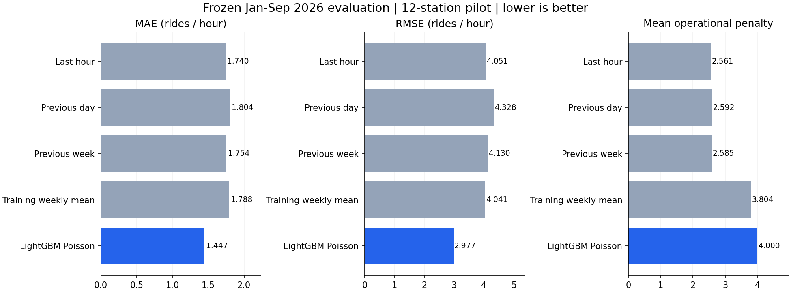
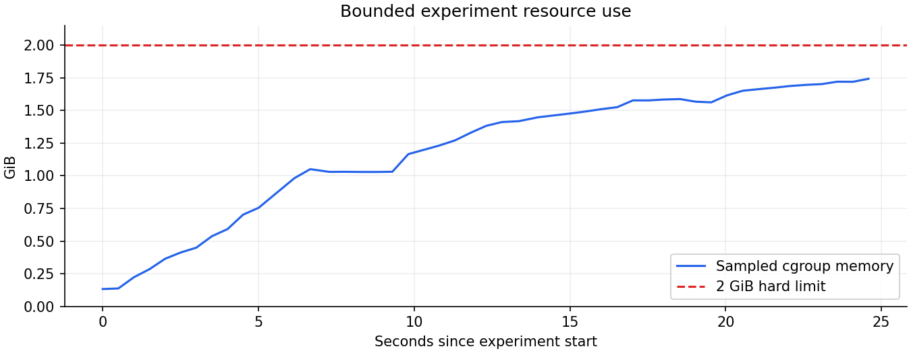

# Bounded ML readiness validation ? October 28, 2026

**Data is ready for bounded ML experiments. The initial count model is not ready for operational promotion.** All 33 month checkpoints and the 2024, 2025 and January?September 2026 year gates are verified. The new experiment improved count errors but increased the existing operational penalty. No HPO, serving-model replacement, commits or pushes were performed.

**Follow-up:** the frozen [decision-policy experiment](DECISION_POLICIES.md) reduced the same count model's post-freeze comparison penalty to 2.0742 without changing its predictions. The initial count-model results below remain unchanged; production serving was not modified.

## Feature and leakage audit

- `jobs/lakehouse.py::_gold` stores Gold ML **observations**, not a persisted feature mart: station ID, UTC hour, departure count, local source year/month and source provenance. The target is observed station departures during hour t. It is served demand, not latent demand when bikes or docks are unavailable.
- Gold creates dense hours for stations present in each source month, filling no-ride hours with zero. It does not establish opening/closing dates or fill wholly absent station-months. That active-month universe is retrospective; new-station/closure forecasting is outside this experiment.
- `jobs/ml_features.py::build_training_features` reconstructs lags 1, 2, 24 and 168 hours and shifted 6/24-hour rolling means and sample standard deviations. Every count input is strictly before t. Current targets, source hashes and revisions are excluded from predictors. Calendar features use America/New_York; lag windows use elapsed UTC hours across DST.
- Features are computed per station across month/year boundaries, with a fresh 168-hour warmup after gaps. Duplicate hours and nonfinite/negative observations are rejected. Selected-station timestamp-based lag/rolling oracles and current/future-target mutation checks passed. Calendar year/month columns were checked against New York timestamps.
- Existing annual audits report zero duplicate station-hour keys and zero invalid feature values, with independent cross-month gap-oracle parity. This run checked those saved gates and all 33 source/checkpoint references; it did not rerun the entire fleet Spark audit.
- The older classifier defaults could use fractional splits because `config/local.yml` omitted a policy. The default is now explicitly `calendar_year`. `jobs/year_features.py` also fences final testing to January?September by default. Regression tests cover these fences and the existing training-only threshold/no-validation-refit behavior.
- The existing one-station classifier workflow remains available. A separate bounded regression runner was added so count MAE/RMSE/WAPE are not mistakenly calculated on Low/Normal/High class IDs. Existing trained models, uploads/data tables and checkpoints are preserved.

## Fixed protocol

`tools/bounded_ml_readiness.py` streamed only the 19,567,940 training-year Gold observations to select 12 deterministic demand-volume ranks among stations with at least 8,000 training hours. Station membership and four training-volume bands used **2024 only**, including low-volume stations; no 2025/2026 survival or accuracy filter was applied. This is a small station cohort, not a fleet-wide estimate.

- Training: **102,503** complete-feature 2024 rows.
- Validation/model selection: **105,120** 2025 rows.
- Final evaluation: **78,612** January?September 2026 rows.
- Forecast protocol: rolling one-hour-ahead with actual observations through t?1 available. Earlier validation/test observations may supply later lag features, but never parameter fitting. This assumes zero observation latency; it is not a fixed-origin nine-month forecast.
- Baselines: last hour; 24 hours earlier; 168 hours earlier; and a station ? local weekday ? hour mean fitted on 2024 only, with a training station-mean fallback.
- One fixed LightGBM Poisson regressor: 100 trees, 15 leaves, learning rate 0.05, minimum child size 40, max bin 63, seed 42, two threads. Predictors are the existing 13 features plus a fixed training-cohort station code. Counts are continuous nonnegative expected rides, without a rounding gate.
- Primary selection criterion was 2025 WAPE, then operational penalty as tie-breaker. There were **zero HPO trials** and no validation refit. LightGBM won that declared criterion. This was not selection on operational penalty.
- `selection_lock.json`, the fitted model, training baselines and class thresholds were written before the first 2026 outcome scan. Model hash and source snapshot/checkpoint hashes were checked unchanged after evaluation. The 2026 results below were inspected once after that lock; the set must not be used for subsequent tuning.

## Metric definitions

MAE = mean absolute ride-count error; RMSE = root mean squared ride-count error; WAPE = sum absolute errors / sum actual rides. WAPE is pooled over station-hours; percentages below are 100 ? that ratio, not classification accuracy. Zero-total slices have undefined WAPE (null), rather than a fabricated zero. Sparse-station WAPE can exceed 100%.

The existing cost matrix is retained: actual-class rows and predicted-class columns are `[[0,10,20],[15,0,10],[30,15,0]]`. Underprediction costs 15 per class tier and overprediction 10. Per-station q25/q75 boundaries are fitted on **2024 complete-feature rows only**: Low < q25; Normal from q25 through q75 inclusive; High > q75. Predicted counts are mapped through the same boundaries. Mean penalty is in project-defined cost units per station-hour, not measured financial loss.

## Actual comparisons

| Split | Model | MAE | RMSE | WAPE | Mean penalty |
|---|---|---:|---:|---:|---:|
| 2025 validation | Last observed hour | 1.7464 | 3.8810 | 52.47% | 2.7074 |
| 2025 validation | Previous day (24h) | 1.7885 | 4.0613 | 53.73% | 2.7243 |
| 2025 validation | Previous week (168h) | 1.7165 | 3.8887 | 51.57% | 2.6400 |
| 2025 validation | 2024 station/weekday/hour mean | 1.6146 | 3.5667 | 48.50% | 3.6336 |
| 2025 validation | LightGBM Poisson | 1.4313 | 2.7971 | 43.00% | 4.0081 |
| 2026 final test | Last observed hour | 1.7405 | 4.0513 | 52.06% | 2.5614 |
| 2026 final test | Previous day (24h) | 1.8043 | 4.3278 | 53.97% | 2.5924 |
| 2026 final test | Previous week (168h) | 1.7537 | 4.1300 | 52.45% | 2.5845 |
| 2026 final test | 2024 station/weekday/hour mean | 1.7880 | 4.0414 | 53.48% | 3.8036 |
| 2026 final test | LightGBM Poisson | 1.4465 | 2.9773 | 43.26% | 4.0003 |



LightGBM has the lowest count errors on both splits. However, **previous-week demand had the lowest validation operational penalty** (2.6400 versus LightGBM 4.0081). That operational disadvantage also appears in the frozen test. Do not promote this count regressor as the existing cost-sensitive classifier champion.

The penalty issue is already visible in training thresholds and validation slices: `SYS033`, `8748.02` and `2883.03` have q25 = q75 = 0. A small positive Poisson mean maps to High, while actual zero counts map to Normal. Many zero-demand hours therefore incur a penalty even when their count error is small. The metric implementation is following the existing contract; no thresholds, rounding gates or prediction decisions were tuned using test results. A zero-aware/cost-sensitive decision layer needs separate validation-only investigation.

## Station, season and demand-level diagnostics

Complete baseline/model slices for both years are in `sliced_metrics.csv`, `validation_slices.json` and `test_slices.json`. The following are descriptive frozen-test diagnostics, not tuning results.

| Station | 2024 volume band | MAE | WAPE | Mean penalty |
|---|---|---:|---:|---:|
| SYS033 | low | 0.3836 | 792.71% | 9.5985 |
| 8748.02 | low | 0.5159 | 280.00% | 8.4705 |
| 2883.03 | low | 0.5121 | 300.05% | 8.6521 |
| 6298.04 | medium_low | 0.5963 | 175.74% | 1.2220 |
| 6520.06 | medium_low | 0.7585 | 110.62% | 3.2919 |
| 6316.05 | medium_low | 0.7632 | 111.85% | 2.8751 |
| 4534.06 | medium_high | 1.0739 | 71.33% | 2.6225 |
| 4095.03 | medium_high | 1.3747 | 65.46% | 2.4408 |
| 4903.09 | medium_high | 1.4530 | 69.60% | 1.5013 |
| 4677.06 | high | 2.1661 | 41.59% | 1.6555 |
| 6339.06 | high | 2.7871 | 34.79% | 3.1102 |
| 6140.05 | high | 4.9739 | 26.05% | 2.5630 |

| Test slice | Rows | MAE | RMSE | WAPE | Mean penalty |
|---|---:|---:|---:|---:|---:|
| fall | 8,640 | 1.7088 | 3.5424 | 39.34% | 4.2569 |
| spring | 26,484 | 1.4419 | 2.8535 | 43.62% | 4.1163 |
| summer | 26,496 | 1.7175 | 3.5158 | 40.28% | 4.3216 |
| winter | 16,992 | 0.8978 | 1.6326 | 61.56% | 3.1880 |
| Low actual demand | 2,556 | 1.2829 | 1.7513 | 272.35% | 2.7308 |
| Normal actual demand | 61,673 | 0.9896 | 1.7884 | 65.57% | 4.1226 |
| High actual demand | 14,383 | 3.4348 | 5.8473 | 29.31% | 3.7012 |

Test winter contains January/February; test fall contains September only. Higher-demand hours have larger absolute errors; low-volume stations have very high relative errors. Aggregate WAPE weights busy stations more heavily, so it must not hide the sparse-station failures. No uncertainty intervals, unseen-station generalization, latency simulation or whole-fleet performance claim is made.

## Runtime and memory

- Model fitting: **0.568 seconds**; scan/feature/fit/evaluation pipeline: **24.627 seconds** (excludes container startup and later plot/test generation).
- Peak charged cgroup memory: **1,870,196,736 bytes (1.742 GiB)** under a **2 GiB** hard cap; no additional swap; two CPU quota and model/BLAS threads.
- Process peak RSS: **1,940,381,696 bytes (1.807 GiB)**. RSS and cgroup charging have different accounting; neither is total Docker-stack memory.
- Kernel memory-limit, OOM and OOM-kill events: **zero**. Memory sampled every 0.5 seconds. `citibike_ml_readiness_01` exited successfully and is retained for diagnostics.



## Artifacts and reproduction

Local, Git-ignored outputs: `artifacts/ml-readiness-01/`. These include model Joblib/native LightGBM files, `config.json` (versions and immutable Iceberg snapshot), selected cohort, 2024 baselines/thresholds, pre-test selection lock/model hash, validation/test aggregate and sliced metrics, genuine test predictions, progress events, memory samples and regression-test XML. Source copies and SHA-256 values are retained in `source/` and `source_sha256.json`. The portable [summary](audit/ml_readiness.json) and the two plots contain only aggregated results.

The current snapshot must match `config.json` before reproducing this run. Use a **new** container/output name; the runner refuses to overwrite an existing run directory. It makes no writes to the source Iceberg catalog, serving models or existing checkpoints. From the project root, with the existing image and completed warehouse available:

```powershell
docker run --name citibike_ml_readiness_02 --network none --cpus=2 --memory=2g --memory-swap=2g --entrypoint python --mount "type=bind,source=$($PWD.Path),target=/opt/airflow" --workdir /opt/airflow -e PYTHONPATH=/opt/airflow -e OMP_NUM_THREADS=2 -e OPENBLAS_NUM_THREADS=2 citibike-airflow-spark-iceberg:3.2.2-python3.11 -u -m tools.bounded_ml_readiness --output /opt/airflow/artifacts/ml-readiness-02 --stations 12
```

This replays the fixed experiment, including final evaluation; do not use repeated test evaluations to select changes. The 2026 data has now been used for this recorded final evaluation. Further development must use 2024/2025 only.

```powershell
.\.venv\Scripts\python.exe -m pytest -q
.\.venv\Scripts\python.exe -m tools.report_bounded_ml --run artifacts/ml-readiness-01
```

Validation: **127 passed, 2 skipped**, with 17 dependency warnings. Host-only Airflow/PySpark checks remain skipped; the real bounded experiment ran in the existing Docker image. New tests cover local-year/test-month fences, count metrics/cost matrix, zero-demand WAPE, invalid predictions, deterministic training-only cohort selection, gap resets, cross-station isolation and training-only historical means.

## Recommended next steps

1. Keep existing serving artifacts unchanged. Treat the Poisson model as a count-forecast pilot, not an operational champion.
2. Investigate zero-heavy stations and a cost-sensitive/zero-aware decision policy on **2024 training and 2025 validation only**. Preserve the cost matrix and explain how counts and class decisions differ. Use a validation penalty constraint alongside count error.
3. Audit station activity/capacity metadata and observed-data latency before operational claims. Assess station-balanced errors and larger training-only cohorts with bounded sampling, rather than loading all Gold rows into pandas.
4. Keep the 2 GiB ceiling until extraction memory is reduced; the peak is already about 87% of that cap. Approve any larger HPO budget only after another bounded resource check.
5. Freeze any future selected configuration before an independently governed final assessment. Do not tune from the station/season/test diagnostics above.
