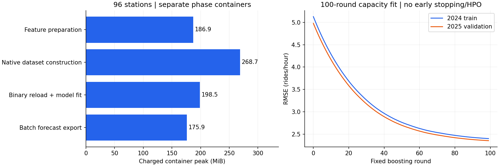

> Historical smoke/96 report. The subsequent authorized 192-station execution is documented in [NATIVE_CAPACITY_192.md](NATIVE_CAPACITY_192.md); statements below about 192 being unrun describe the earlier stage.

# Bounded native LightGBM integration ? October 29, 2026

**Implemented and validated: a four-station learner smoke test followed by the admitted 96-station capacity stage.** Both use 2024 for fitting and 2025 for validation only. All phase memory/correctness gates passed. A controlled **192-station capacity stage is reasonable to authorize next**, under the same limits, but **it has not run and remains disabled**. No frozen decision policy was changed or applied to a different model, no held-out data was read, and nothing was deployed.

## Integration and boundedness

`jobs/native_lgbm.py` and `tools/native_network_capacity.py` connect the existing station feature stream to native LightGBM:

1. Read projected source Parquet batches for **2024/2025 only** from the pinned Iceberg snapshot. The four-station smoke cohort comes from 2024 demand ranks within the existing planned 96 cohort; the capacity run uses the exact planned 96 station IDs.
2. Partition raw rows through an **eight-writer LRU pool**. Evicted keys reopen as new immutable part files; no closed Parquet file is overwritten or appended incorrectly.
3. Sort at most **17,544 source rows for one station** at a time, with a hard 18,000-row guard. Process <=4,096-row feature chunks with **168 raw rows of carry**. No full-cohort training/validation DataFrame is created.
4. Append float32 X/y files and station/time/actual row keys in the same order. Seal all files with SHA-256 and canonical UTC-nanosecond row-key hashes.
5. `DiskSequence(lightgbm.Sequence)` feeds the memory maps to the native Dataset constructor. The installed LightGBM 4.6.0 API requires float64 **sample rows**; only individual sampled rows are converted. Native push batches remain float32. Training samples at most 200,000 rows for bin construction; **all training rows**, not merely that sample, enter the fit.
6. Construct validation with `reference=train`, verify native feature names/bin counts/labels, and persist `train.bin` and `validation.bin`. Validation makes **zero scalar sampling reads**, proving this code path does not independently estimate validation bins.
7. In a separate fit container, reload the binaries, verify all labels and feature order again, then call native `lightgbm.train` with fixed parameters. There is no repeated station-batch fit, no full pandas matrix, no early stopping and no HPO.
8. A separate export container reads 4,096-row blocks, retains every training and validation forecast, and verifies prediction row-key/label parity against the feature matrices.

Native binned datasets, gradient buffers and a limited bin-sampling array are still resident. Disk mapping is not online learning and does not guarantee that the complete network fits; actual capacity was measured only at four and 96 stations.

## Smoke admission and resource gates

The smoke run used **34,464 training rows**, **35,040 validation rows** and **10 boosting rounds**. The fit took **0.108 seconds**. It reduced native training Poisson loss, produced finite predictions, retained every row and stayed under all limits. Its short-run count errors are not a model-quality approval. Only after prepare/construct/fit/export all completed did 96-station admission pass.

- Every container had a **2,147,483,648-byte hard cap**, **zero additional swap**, two CPU quota and two native/BLAS threads. One capacity phase ran at a time.
- The memory watchdog samples charged usage every **20 ms** and exits with a retained resource-stop marker at **85% of the cap**. Completed kernel high-water marks and memory-event counters are also admission gates; no resource limit was increased.
- Host-disk heartbeat/reserve checks remain active. Source/data/code hashes and native-binary hashes are checked between phases. New directories are mandatory; old outputs/models/checkpoints are not overwritten.
- The executed phase sources are preserved under each run's `source/`. Delivered code additionally makes the phase-admission checks explicit at every transition/completion. All measured results satisfy these checks.
- The CLI and `config/native_network_capacity.yml` authorize only `smoke` and `96`; stage 192, stage 384 and full-network training remain unavailable to this entry point.

## Actual 96-station measurements

Rows: **827,136 training**, **840,960 validation**. Raw selected observations: 1,684,224. Source scan: 38,820,660 development Gold observations. The stream uses <=4,096 rows per feature/native batch and retains <=168 raw rows; peak open raw writers: **eight**.

Each phase ran in its **own container**, so kernel high-water marks are isolated per phase rather than inherited from an earlier stage:

| Phase | Measured phase work | Charged kernel peak |
|---|---:|---:|
| Feature preparation / matrix write | 219.454 s | 186.95 MiB |
| Native dataset construction + binary write | 9.102 s | 268.73 MiB |
| Native binary reload + fitting/checkpoint save | 15.128 s | 198.53 MiB |
| Batched forecast export + hash verification | 23.032 s | 175.87 MiB |

- Pure native boosting time: **7.750 seconds** for **100 fixed rounds**. Fitting-interval sampled charged peak: **198.53 MiB**, matching that fit-container kernel maximum. Binary reload sampled peak was 172.49 MiB.
- Native construction sampled anonymous-memory peak: **169.91 MiB**; fitting sampled anonymous peak: **188.20 MiB**. Anonymous usage includes Python and native allocations; it is not a native-only allocator measurement. Charged peaks also include file cache. Peak fields are not additive.
- Preparation throughput: approximately **7,601 feature rows/s**, including source read, bounded sorting, all continuity/parity assertions and disk writes.
- Native build throughput: approximately **183,264 rows/s**, including verification and binary writes.
- Batched model prediction time: **3.466 seconds** for all **1,668,096** development rows: approximately **481,274 rows/s**. Export phase time also includes key IO, metrics, serialization and hashes.
- Sum of the four phase-work intervals: **266.716 seconds**. This excludes container startup/imports and manual orchestration gaps; it is not an uninterrupted wall-clock training duration.
- Memory-limit, OOM and OOM-kill events: **zero in every smoke and capacity phase**. The 85% stop gate was never reached.



Training and validation binary sizes are **12,828,144** and **13,101,184 bytes**. Raw float32 matrices remain available for reproducibility but are never converted into whole-population DataFrames. Preparation is now the dominant cost, especially many small bind-mounted files and exhaustive integrity checks. Optimization of this IO is future work, not evidence of a training-memory failure.

## Correctness and reproducible artifacts

- All 96 station identities, labels and hour keys were checked. Each history has 17,544 unique consecutive UTC hours across 2024/2025; each produces 8,616 training rows and 8,760 validation rows, preserving context at the year boundary.
- Direct timestamp lookups verified all 1/2/24/168-hour lag values over every generated row; all streamed features were compared with the existing whole-station feature implementation. Target timestamps and ordering matched. No absent rows were manufactured.
- All 14 feature names/order, row counts and labels matched before binary save and after reload. A post-run audit also verified every native float32 label equals the original integer count without rounding; delivered code rejects any future count that is not exactly representable. Station-code mapping is new and explicit for this 96-station capacity model; no old map was silently extrapolated.
- Matrix X/y/key hashes, native-bin hashes, source snapshot/input hashes, software versions and executed source code were retained. Training and validation bins have identical bin-count layouts and a shared training reference.
- Construction made **200,000** training scalar reads, **0** validation scalar reads, 202 training push batches and 206 validation push batches; maximum push size **4096**.
- All **827,136 training forecasts** and **840,960 validation forecasts** are persisted. Their row-key hashes and labels match matrix inputs. Batched-export MAE/RMSE reproduce the native learner's final evaluation metrics at 1e-10 relative tolerance.
- Checkpoints were saved at rounds **20, 40, 60, 80 and 100**, in the new run only. These preserve completed boosting artifacts; a general interrupted-fit resume workflow is not yet implemented or claimed.
- Capacity model SHA-256: `1139e3eb1cf8f40bf83b0850f202180ad844b83035c16878e4731ce08537de8e`.

The stored model text contains the fixed parameters and feature names. Software/version records and code snapshots make the run reproducible; model hashes are not a promise of bit-identical results across arbitrary hardware or versions. Native Poisson loss may be negative because the reported objective omits a label-dependent constant; finite negative values here are not NaNs or numerical failure.

## Count-model sanity metrics ? not operational certification

| 96-station split | Rows | MAE | RMSE | WAPE |
|---|---:|---:|---:|---:|
| 2024 training | 827,136 | 1.2962 | 2.3995 | 52.48% |
| 2025 validation | 840,960 | 1.2845 | 2.3530 | 52.61% |

These are genuine count-forecast measurements for the capacity experiment, not a comparison against the differently composed 48-station model. No decision calibration was fitted, no frozen empirical policy/fallback was reused on a different model, and no operational penalty/seasonal decision-guard certification is claimed. The retention manifest records that limitation explicitly. Quality gates remain a separate development-only step before any promotion.

The current numerical `station_code` yields **62 native bins for 96 IDs** under the fixed max-bin setting. Raw ID/code alignment is correct, but the model does not get an independent numerical bin for every station. This known modeling limitation is left unchanged; any categorical/identity alternative requires a separately declared development experiment, not a capacity-test adjustment.

## Is 192 safe to authorize?

**Yes, as one controlled resource/correctness capacity stage under the same cap and stop gates?not as deployment or operational-policy approval.** The recommendation uses the observed four/96-station phase peaks, a two-point linear projection to 192, and an additional 25% margin.

| Phase | Projected 192 peak including margin |
|---|---:|
| Feature preparation / matrix write | 0.239 GiB |
| Native dataset construction + binary write | 0.496 GiB |
| Native binary reload + fitting/checkpoint save | 0.318 GiB |
| Batched forecast export + hash verification | 0.268 GiB |

The largest projection is approximately **0.496 GiB**, below the unchanged **1.7 GiB stop gate**. This is an estimate, not a measured 192-stage peak: cache ownership, native allocations and nonlinear behavior can differ. Repeat all resource/correctness admissions at 192, preserve checkpoints and stop on any breach. It does not authorize 384 or the whole network. No 192 process was started; both CLI scope and larger-stage flags remain disabled.

## Tests and preservation

**165 passed, two skipped, three deselected**, with 14 dependency warnings. New regressions verify Sequence dtype/batch behavior, immutable reopenable writer parts, label/hash tamper detection, conservative projection and memory-event/headroom admission. Three unrelated real learner-fit tests were deselected so all actual learner fits for this task occurred only in the capped phase containers. Host-only Airflow/PySpark checks remain skipped; actual native learner integration was exercised by the two controlled runs.

Only new capacity-run artifacts and implementation/documentation were written. Original datasets, monthly checkpoints, existing trained models, empirical policies, fallback rules and production serving were preserved. Protected model/policy hashes are recorded separately. No 2026 data was inspected/scored, no HPO was run, and no deployment, commits or pushes occurred.

## Paths and reproduction

- New runs: `artifacts/native-network-capacity-01/smoke/` and `artifacts/native-network-capacity-01/96/`.
- Each contains the experiment/phase results, raw parts, X/y/key matrices, native binaries, model, source snapshots/hashes, memory CSVs and complete forecast retention evidence.
- 96-station model: `96/capacity_model.txt`; checkpoints: `96/checkpoints/`; summaries: `capacity_summary.json` and [portable audit](audit/native_capacity.json).
- `config/native_network_capacity.yml` scopes only smoke/96. `config/network_scaling_plan.yml` remains planning-only for larger stages.

To reproduce, choose a new artifact root and container names. Run each phase sequentially, checking its exit status/result before the next phase. One phase command template is:

```powershell
docker run --name citibike_native_smoke_prepare_02 --network none --cpus=2 --memory=2g --memory-swap=2g --entrypoint python --mount "type=bind,source=$($PWD.Path),target=/opt/airflow" --workdir /opt/airflow -e PYTHONPATH=/opt/airflow -e OMP_NUM_THREADS=2 -e OPENBLAS_NUM_THREADS=2 citibike-airflow-spark-iceberg:3.2.2-python3.11 -u -m tools.native_network_capacity --stage smoke --phase prepare --run /opt/airflow/artifacts/native-network-capacity-02/smoke
```

Use phases `prepare`, `construct`, `fit`, `export` in that order, with unique container names. After all smoke phases pass, the same sequence for `--stage 96` requires `--smoke-run /opt/airflow/artifacts/native-network-capacity-02/smoke`. Existing phase/run directories are refused, rather than overwritten. Do not edit recorded source code between phases.

Read-only verification/reporting and regression command:

```powershell
.\.venv\Scripts\python.exe -B -m tools.report_native_capacity
.\.venv\Scripts\python.exe -B -m pytest -q -k "not small_model_families_and_genuine_metrics"
```

The report tool validates hashes and saved native/export metrics; it does not train or predict. Future 192 authorization would require an explicit scoped update and a new run directory; it is not an automatic continuation.
