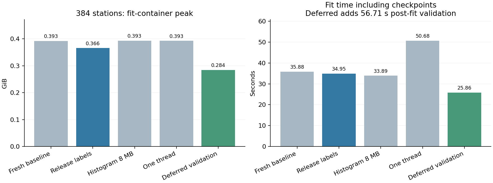

# Native LightGBM fitting memory

This investigation uses the saved native datasets and immutable feature matrices from the verified **96/192/384-station** capacity stages. Training is 2024 only; validation is 2025 only. No 2026 records or outcomes are accessed. Full-network execution stays disabled. Existing serving models, frozen policies and artifacts are not modified.

## Controls and implementation

Every actual fit, deferred validation pass and export runs sequentially in its own container with two CPUs, **2 GiB hard memory**, zero extra swap, no network and the unchanged **1.7 GiB stop gate**. `tools/profile_native_fit.py` accepts only 96/192/384 stations and new run names. It hashes native inputs and source, checks every loaded label in bounded slices, verifies row counts/feature order, and saves checkpoints at rounds 20/40/60/80/100.

Profiling separates binary reload, label/feature integrity, fitting, checkpoint generation, finalization and final save. The kernel high-water applies to the whole container; **subphase peaks are sampled at 20 ms plus forced boundary snapshots**, not independently reset kernel maxima. `/proc/self/smaps_rollup`, cgroup anonymous/file memory, OS thread counts, Python label-cache bytes and Python prediction-buffer bytes are recorded. Snapshot/guard overhead is included in measured fit time. Model-save call time is measured separately.

`jobs/native_fit_memory.py` adds opt-in controls:

- **compact:** release redundant Python label copies after verification and trim freed glibc allocations. It never calls `set_label(None)` and does not modify native labels. In-loop validation, parameters and checkpoint selection remain unchanged. This is tested with the built-in Poisson objective/metrics; custom Python metrics can repopulate label caches and require separate resource validation.
- **hist8:** cap historical histogram cache at 8 MB. This changes serialized parameter metadata, so model hashes must be distinguished from predictive equivalence.
- **one_thread:** use one learner thread; other container limits remain unchanged. Actual OS thread counts include the monitor and library threads.
- **deferred:** apply compact cleanup and omit the validation Dataset during a **fixed 100-round** fit. It is explicitly forbidden for early stopping or a different iteration budget. This changes evaluation timing, not the fixed-budget training algorithm. It is not a general replacement for in-loop validation during early stopping or evaluation-dependent learning-rate schedules.

For deferred validation, `tools/native_deferred_curves.py` reconstructs all 100 validation-round curves in bounded 4,096-row batches, using each saved tree's raw contribution and the Poisson exponential link. Prefix predictions are checked against ordinary model prediction at rounds 1/20/100. Every row/key is checked, and recovered MAE/RMSE/Poisson curves are compared with the original native curves. Full training/validation exports follow in a separate process.

## Source review and attribution limits

The installed LightGBM 4.6.0 Python wrapper copies native label fields into NumPy arrays and caches them on `Dataset.label`. Built-in metrics evaluate in C++; observed Python prediction buffers can therefore be distinguished from the native score arrays. The [versioned native score updater](https://raw.githubusercontent.com/microsoft/LightGBM/v4.6.0/src/boosting/score_updater.hpp) stores one double score per row. At 384 stations that implies about **25.24 MiB training and 25.66 MiB validation** score storage, excluding datasets and other learner state.

The [native gradient types](https://raw.githubusercontent.com/microsoft/LightGBM/v4.6.0/include/LightGBM/meta.h) default to float32 and [GBDT](https://raw.githubusercontent.com/microsoft/LightGBM/v4.6.0/src/boosting/gbdt.cpp) retains training data, score updaters, gradients/Hessians and learner state. These source-derived sizes explain mechanisms; they are not an exact native heap allocation trace, and custom-build flags were not independently audited.

The original fit already forces col-wise learning. Switching to row-wise can increase Dataset memory; it is not adopted. [`histogram_pool_size`](https://lightgbm.readthedocs.io/en/v4.6.0/Parameters.html#histogram_pool_size) addresses histogram history, not all learner memory. Gradient quantization changes training arithmetic and would require a separate quality experiment; it is not silently introduced. The default end-of-training model conversion releases training state; retaining a training Booster is not assumed to save peak memory. Checkpoint writes retain the existing schedule.

## Reproduction and restart

Use fresh run/container names. Never overwrite completed or partial phases:

```powershell
docker run -d --name citibike_fitmem_reproduce --network none --cpus=2 --memory=2g --memory-swap=2g --entrypoint python --mount "type=bind,source=$($PWD.Path),target=/opt/airflow" --workdir /opt/airflow -e PYTHONPATH=/opt/airflow -e OMP_NUM_THREADS=2 -e OPENBLAS_NUM_THREADS=2 citibike-airflow-spark-iceberg:3.2.2-python3.11 -u -m tools.profile_native_fit --stations 384 --variant compact --run-name reproduce384
```

For a deferred trial, use `--variant deferred`, wait for the fit to exit zero, then run `python -m tools.native_deferred_curves --run-name <name>` inside another container with the same cap/mount/environment. Finally run `tools.profile_native_fit --phase export` with the original station count, variant and run name, using a fresh container name. Keep recorded code unchanged between fitting and export. Completed fits/checkpoints remain reusable for subsequent validation/export; automatic mid-fit continuation is still unsupported.

Read-only reconciliation, chart generation and regressions:

```powershell
.\.venv\Scripts\python.exe -B -m tools.report_native_fit
.\.venv\Scripts\python.exe -B -m pytest -q -k "not small_model_families_and_genuine_metrics"
```

## Verified 384-station results

Every fit uses the same **3,308,544 training rows**, native feature order and original binning; in-loop validation uses **3,363,840 rows**. All five checkpoints are retained.

| Configuration | Binary reload seconds | Fit seconds including checkpoints | Checkpoint-save seconds | Container peak GiB | Model SHA identical? |
|---|---:|---:|---:|---:|---|
| Original verified 384 baseline | Not separately recorded | 33.491 | Not separately recorded | 0.408 | Reference |
| Fresh baseline | 1.217 | 35.879 | 0.201 | 0.393 | Yes |
| Release Python labels + trim | 1.020 | 34.946 | 0.172 | 0.366 | Yes |
| Histogram pool 8 MB | 1.115 | 33.886 | 0.197 | 0.393 | No; metadata differs |
| One learner thread | 1.130 | 50.683 | 0.228 | 0.393 | No; metadata differs |
| Deferred validation + release labels | 0.557 | 25.858 | 0.193 | 0.284 | Yes |

The compact option reduces the matched fresh-baseline peak by **6.78%**, or **10.27%** against the original baseline. It preserves in-loop validation and exact model/checkpoint bytes. Deferred validation reduces the fresh-baseline fit peak by **27.58%**, with the protocol restrictions described above.

The original 60.17-second whole fit phase also included complete disk-matrix verification; the new harness verifies immutable native hashes plus all loaded labels/features. Compare fit durations, not whole phase totals, for learner timing. Fresh measurements include more snapshots than the original run and are single runs, so small runtime differences are not precise speedup estimates.



## Subphase profiling and findings

The following are sampled charged-memory peaks, not independently reset kernel high-water marks. Checkpoint and fitting peaks include the same live model/datasets, so their values must not be added.

| Subphase | Fresh baseline GiB | Compact GiB | Deferred GiB |
|---|---:|---:|---:|
| binary_reload | 0.252 | 0.256 | 0.183 |
| label_and_feature_integrity | 0.267 | 0.267 | 0.194 |
| model_fitting | 0.392 | 0.366 | 0.284 |
| checkpoint_generation | 0.392 | 0.366 | 0.284 |
| model_finalization | 0.392 | 0.365 | 0.284 |
| final_model_save | 0.342 | 0.316 | 0.260 |

- **Native datasets:** the standard fit retains both training and validation datasets. Deferred fitting retains only training; recorded validation rows during fitting are zero. This is a timing change with mandatory post-fit validation, not removal of validation evidence.
- **Unnecessary Python copies:** the fresh baseline retains **26,689,536 bytes (25.45 MiB)** of copied labels throughout fitting. Compact fitting records zero Python label-cache bytes at every sampled iteration while leaving native labels intact. Cleanup/allocator trimming saves roughly the expected amount.
- **Prediction caches:** Python inner-prediction buffers were **zero bytes** in all recorded built-in-metric iterations. Native score caches still exist; source-derived training/validation score storage totals approximately **50.91 MiB** at 384 stations. A custom Python objective/metric could introduce additional buffers and is outside this result.
- **Histogram history:** the 8 MB limit did not improve memory, and predictive tree structure/native validation results were unchanged. With this small feature/leaf configuration it is not the dominant measured allocation.
- **Threading:** one learner thread reduced recorded OS threads from six to five, but did not meaningfully reduce peak memory and increased fit time from 35.88 to 50.68 seconds. Keep two threads.
- **Checkpoints:** five save calls totaled **0.201 seconds** in the fresh baseline; the final file was **191,269 bytes**. Sampled checkpoint peaks stayed close to fitting peaks, with no large checkpoint-only spike observed. Existing checkpoint frequency is preserved.
- **Finalization:** memory falls after training-state conversion/release, while externally retained datasets and allocator state remain. There is no demonstrated benefit from retaining the full training Booster. Exact C++ heap-class attribution was not performed; native storage, score arrays and allocator state must not be confused with Python prediction caches.

## Model quality and deferred-validation evidence

| Configuration | 2025 MAE | 2025 RMSE | 2025 WAPE | Predictive tree signature identical? |
|---|---:|---:|---:|---|
| Fresh baseline | 1.257711233 | 2.313768752 | 53.896259% | Yes |
| Release Python labels + trim | 1.257711233 | 2.313768752 | 53.896259% | Yes |
| Histogram pool 8 MB | 1.257711233 | 2.313768752 | 53.896259% | Yes |
| One learner thread | 1.257711233 | 2.313768752 | 53.896259% | Yes |
| Deferred validation + release labels | 1.257711233 | 2.313768752 | 53.896259% | Yes |

Baseline, compact and deferred models/checkpoints are byte-identical. Histogram/thread options change serialized parameters, so they are not called byte-identical models; the predictive split/leaf/feature/objective signatures matched, and every-row native validation supplied fresh quality evidence. Tiny one-thread metric differences are floating-point aggregation differences; no quality improvement is claimed. Their small/no memory benefit does not justify changing defaults.

Deferred validation reconstructed all **100** validation-round MAE/RMSE/Poisson curves on **3,363,840 rows** in **56.713 seconds**, peaking at **0.150 GiB**. Maximum absolute differences from original native curves were **3.86e-11 MAE**, **3.78e-11 RMSE** and **1.36e-11 Poisson**, within the predeclared 1e-10 relative/absolute tolerances. Validation rows and row-key hashes matched exactly.

The entire training and validation forecast Parquet files were exported and verified byte-identical to the original baseline. Final validation metrics remain **MAE 1.257711233, RMSE 2.313768752, WAPE 53.896259%**. Native training history and recovered validation history remain separate files, with evaluation timing explicitly recorded. Nothing is retrospectively labeled as in-loop validation.

**Runtime tradeoff:** deferred fitting plus curve reconstruction takes at least **82.57 seconds**, before its reload/integrity overhead and normal forecast export, versus the fresh in-loop fit's **35.88 seconds**. It is a memory optimization, not an end-to-end speedup. Do not use it for early stopping or callbacks that depend on validation during optimization.

## Conservative full-network projections

| Variant / cohort | 96 peak GiB | 192 peak GiB | 384 peak GiB | Projected 1,898 fitting GiB |
|---|---:|---:|---:|---:|
| Compact, in-loop validation | 0.180 | 0.241 | 0.366 | 2.714 |
| Deferred fixed-budget validation | 0.160 | 0.203 | 0.284 | 2.108 |

These use the upper envelope of proportional scaling and the largest nonnegative measured pairwise slope, plus **50% margin**. The already verified buffered construction projection remains **2.553 GiB**. Fitting projects at **2.714 GiB** with in-loop validation preserved, or **2.108 GiB** with fixed-budget deferred validation. The previous unchanged export projection is approximately **2.374 GiB**; it was not optimized here. These are estimates, not measured full-network bounds; proportional scaling deliberately overcounts fixed overhead.

**Do not authorize 1,898 stations under the current 2 GiB cap or 1.7 GiB stop gate.** Even deferred fitting leaves construction above the cap, and its own conservative fit estimate also exceeds it. A **separately validated 4 GiB-or-larger worker**, with sufficient host RAM and staged intermediate checks, is the recommended path. Its 85% gate would be 3.4 GiB; this does not guarantee safety or authorize a larger cap/full-network run. Further work under 2 GiB must reduce resident native datasets/learner state and remaining construction/export memory rather than weaken safeguards.

## Tests and preservation

**176 passed, two skipped, three unrelated learner-fit tests deselected**, with 14 dependency warnings. Four new regressions protect immutable parameters, prevent unsafe deferred-validation protocols, ensure Python cache release cannot clear native labels, and verify incremental prediction alignment/finiteness. Real fits, curve recovery and export occurred only in capped containers.

All **80 protected hashes** remained unchanged, including the original 384 matrices/native binaries/model/forecasts/checkpoints, previous selected optimized artifacts and frozen policies. No production serving, datasets or checkpoints were overwritten. There was no full-network execution, 2026 access, deployment, commit or push.

New results are under `artifacts/native-fit-memory-01/`: per-run experiment/source snapshots, fit memory CSVs and allocation snapshots, curves/checkpoints, `deferred384/deferred_validation_curves.json`, complete deferred forecast files, `container_execution.txt`, `tests.xml`, and `summary.json`. See the [portable machine-readable audit](audit/native_fit_memory.json).

All **11 benchmark containers** exited zero with the verified image, 2 GiB cap, zero extra swap and two-CPU quota. Recorded host monitoring supplied **72 heartbeats** with maximum gap **10.41 seconds** and minimum free disk **31.05 GiB**. Resource evidence is saved in `resource_verification.json`; a direct invalid-stage CLI check confirms 1,898 remains blocked.
