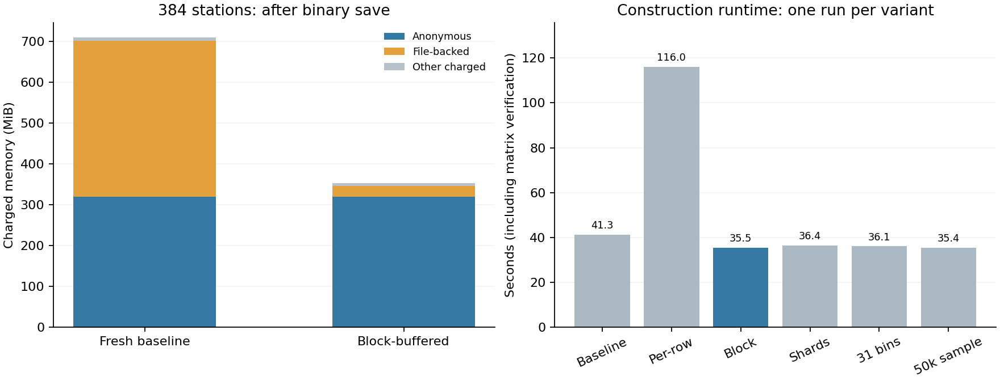

> Subsequent fitting-memory measurements and updated projections are in [NATIVE_FIT_MEMORY.md](NATIVE_FIT_MEMORY.md). The construction measurements below remain unchanged.

# Native LightGBM construction memory investigation

This investigation reuses immutable 2024/2025 matrices from the verified 96/192/384 capacity stages. No features are regenerated, no 2026 records/outcomes are accessed, and full-network training remains disabled. Every real construction/fit/export benchmark runs sequentially in a separate two-CPU container with a **2 GiB cap**, no extra swap, no network and the existing **1.7 GiB stop gate**. The host disk reserve and heartbeat checks remain active.

## Implemented opt-in optimization

`jobs/native_streaming.py` provides two adapters alongside the unchanged `DiskSequence`:

- `BufferedDiskSequence`: explicit reads into one reusable float32 batch buffer, independent float64 sampled rows and advisory release of this feature file's clean cache pages.
- `BlockBufferedDiskSequence`: additionally caches one 4,096-row sample window. LightGBM 4.6.0 samples in increasing row order, so this eliminates most small read/seek operations while returning exactly the same sampled values. Arbitrary valid sample indices still work; changing windows reloads them.

The buffer is **229,376 bytes** for 4,096 rows and 14 features. Returned batch arrays are borrowed and valid until the next adapter access; sampled rows own their float64 data. Use this adapter only with synchronous consumers such as the tested native Sequence constructor. It is not a thread-safe/general-purpose replacement for persistent array slices. Cache release is advisory, Linux-specific and scoped to the adapter's read-only feature file. It does not change bytes or global kernel cache settings. Unsupported advice fails explicitly; there is no silent promise of equivalent memory bounds on other platforms/filesystems.

Original matrices, labels, keys, feature semantics, station codes and binning parameters are preserved. `max_bin=63`, sample count 200,000, seed 42 and training-reference validation bins remain unchanged for the selected candidate. Original training, serving and frozen policies are untouched; the optimization is opt-in, not a deployment.

## Options evaluated

- **Float32 / feature types:** the existing matrix already uses float32. Integer-valued features and targets are checked for exact representation. Continuous rolling statistics and cyclical features make float16 or integer conversion a semantic change; not adopted. Marking station codes categorical would also change model semantics and is not adopted.
- **Native options:** `free_raw_data=True` and col-wise fitting already apply. [`two_round`](https://lightgbm.readthedocs.io/en/v4.6.0/Parameters.html#two_round) applies to direct text-file loading, not this Sequence input. Histogram-cache limits govern fitting, not the mapped input pages identified here. No unsupported native flag is claimed to fix construction memory.
- **Binning:** controlled 31-bin and 50,000-sample ablations are evaluated separately, with fresh native binaries/models and validation results. They change bin boundaries and are not treated as byte-equivalent optimizations. LightGBM already compresses native bin storage; lowering 63 to 31 does not guarantee a proportional row-storage saving. See [official dataset parameters](https://lightgbm.readthedocs.io/en/v4.6.0/Parameters.html#dataset-parameters).
- **Sharding:** 131,072-row Sequence views preserve global row order and one training-derived bin mapper. This tests sharded *input*, not independent binary-file concatenation. The final native Dataset still contains every row. The supported Python API does not supply an arbitrary binary-shard concatenation/external-memory training mode. Independently fitting station shards or warm-starting repeatedly would change the global learning procedure and is not implemented.
- **Temporary buffers:** one reusable float32 batch and one bounded sample window replace persistent feature mappings. The float64 sampled rows remain independent because the installed Python sampler retains them before bin construction. Those sampling allocations and native train/validation Dataset storage remain; they are not disguised as fully external-memory training.

## Methodology and safeguards

`tools/profile_native_construction.py` accepts only 96, 192 or 384 stations and refuses existing phase directories. It verifies original matrix hashes, role years, keys and labels; records cgroup high-water memory, 20 ms phase samples and `/proc/self/smaps_rollup`/cgroup snapshots before and after verification, training construction, validation construction and binary save. Matching native binary hashes provide a stronger bin/row-order equivalence check than counts alone.

Fresh fits use the same Poisson settings, 100 rounds, two threads and checkpoints every 20 rounds. Native files and executed code are hashed before subsequent phases. Exports reuse the verified bounded exporter and retain every training/validation forecast with keys and labels. Export metrics and row-key hashes are independently recomputed by `tools/report_native_memory.py`. Non-equivalent ablations use validation only; there is no held-out tuning.

The benchmark fit harness validates binaries by hash rather than repeating the original fit phase's complete matrix verification. Compare **pure boosting** times, not whole fit phase times, when assessing learner speed. Constructor variants repeat the same verification workload. Single-run timings can vary with host load and filesystem cache ownership; the original and freshly repeated baselines are reported separately.

## Reproduction

Use a new run name/container name. The existing completed runs must not be overwritten:

```powershell
docker run -d --name citibike_mem_reproduce_construct --network none --cpus=2 --memory=2g --memory-swap=2g --entrypoint python --mount "type=bind,source=$($PWD.Path),target=/opt/airflow" --workdir /opt/airflow -e PYTHONPATH=/opt/airflow -e OMP_NUM_THREADS=2 -e OPENBLAS_NUM_THREADS=2 citibike-airflow-spark-iceberg:3.2.2-python3.11 -u -m tools.profile_native_construction --stations 384 --variant buffered --phase construct --run-name reproduce384
```

After a phase exits zero and its result passes admission, use a new container name with `--phase fit`, then `--phase export`, keeping the same run name, source and variant. Do not change recorded code between phases. Completed construction can be reused; checkpoints are retained, but automatic mid-fit continuation remains unsupported. Do not use the initial slow `stream` trial as the selected candidate.

```powershell
.\.venv\Scripts\python.exe -B -m tools.report_native_memory
.\.venv\Scripts\python.exe -B -m pytest -q -k "not small_model_families_and_genuine_metrics"
```

Docker commands run directly in PowerShell. The temporary `.ps1` batch launcher was rejected by this host's existing execution policy; no policy was changed, and benchmarks continued with direct Docker commands.

## Confirmed allocation sources

The fresh baseline reproduced **both original 384 native binary hashes**. At its post-save snapshot, anonymous memory was **319.69 MiB**, file-backed memory **381.83 MiB**, and total charged memory **710.53 MiB**. The optimized post-save snapshot had **320.13 MiB anonymous** and **25.49 MiB file-backed**. The anonymous component scarcely changed; the reduction is input-file residency.

The difference in file-backed memory is **373,653,504 bytes**, exactly the two float32 feature matrices combined (**6,672,384 rows x 14 features x 4 bytes**). The retained `DiskSequence` helper objects hold their feature mappings through train/validation construction and binary saving; `free_raw_data=True` does not close external helper references. Validation and training both populate those mappings. The optimized reader removes those mappings and releases its clean input cache while preserving the bytes. Label mappings remain. This is not evidence of a native LightGBM leak.

Remaining anonymous allocations include interpreter/library state, sampled arrays, native train/validation datasets and allocator/binary-save buffers. In the baseline, anonymous memory rose from about 118.61 MiB after verification to 204.43 MiB after training construction, 287.61 MiB after validation construction and 319.69 MiB after saving. These are phase snapshots, not an exact allocation trace for individual C++ classes. No native heap-profiler attribution is claimed.



## Measured construction results

All 384 trials use **3,308,544 training and 3,363,840 validation rows**, unchanged keys/labels/order. Durations include source-matrix verification and binary save.

| Configuration | Seconds | Kernel peak GiB | Original binaries identical? |
|---|---:|---:|---|
| Original verified 384 baseline | 35.863 | 0.694 | Reference |
| Fresh baseline repeat | 41.263 | 0.694 | Yes |
| Per-row streaming prototype | 116.040 | 0.364 | Yes |
| Block-cached buffered reader, 63 bins | 35.459 | 0.344 | Yes |
| Buffered input shards, 63 bins | 36.430 | 0.347 | Yes |
| Buffered reader, 31 bins | 36.092 | 0.343 | No; binning changed |
| Buffered reader, 50,000 bin samples | 35.423 | 0.343 | No; binning changed |

The selected block-cached reader reduces peak construction memory by **50.41%** against the original baseline. Runtime is comparable to the original 35.86-second measurement and faster than the fresh 41.26-second repeat; these single runs do not establish a precise speedup. It reads **808 sample windows instead of 200,000 individual sample-row file reads**, returning all 200,000 original sampled values. Validation independently samples zero binning rows.

The 31-bin and 50,000-sample alternatives saved under 0.5% of peak memory relative to the selected buffered reader and changed the bins. Sharded input did not reduce native global-dataset memory. Retain the original binning and feature types.

## Forecast equivalence and ablations

| Configuration | Validation MAE | Validation RMSE | Validation WAPE | Pure boosting seconds |
|---|---:|---:|---:|---:|
| Original baseline | 1.257711233 | 2.313768752 | 53.896259% | 33.491 |
| Selected buffered, original bins | 1.257711233 | 2.313768752 | 53.896259% | 33.309 |
| 31 bins | 1.257709646 | 2.316078865 | 53.896191% | 34.491 |
| 50,000 samples | 1.257785612 | 2.315302651 | 53.899446% | 34.031 |

The selected candidate has **byte-identical training/validation binaries, final model, and both complete prediction Parquet files**. Thus its count forecasts and MAE/RMSE/WAPE are unchanged, not just statistically similar. Every ablation retains its own model, curves, checkpoints and complete forecasts. Export metrics were independently reconstructed from bounded Parquet batches, with row-key/label hashes checked; MAE/RMSE match native history within 1e-10 and independent export recomputation within 1e-12.

The new bounded fits are construction-option experiments, not operational-policy or full-network quality certification. All metrics use 2025 validation only; none were derived from the 2026 holdout. The sharded and per-row prototype datasets were not refit: their exact binary equivalence is recorded without claiming new prediction measurements for those two trials.

## Scaling projection and recommendation

| Buffered construction cohort | Train / validation rows | Seconds | Kernel peak GiB |
|---|---:|---:|---:|
| 96 | 827,136 / 840,960 | 9.795 | 0.198 |
| 192 | 1,654,272 / 1,681,920 | 19.027 | 0.233 |
| 384 | 3,308,544 / 3,363,840 | 35.459 | 0.344 |

Use the same conservative distant-extrapolation rule as the previous report: the upper envelope of proportional scaling and worst nonnegative observed pairwise slope, then **50% margin**. The selected construction projection for 1,898 stations falls from **5.148 GiB to 2.553 GiB**. These are estimates, not measured full-network peaks.

| Full-network phase | Conservative projected GiB |
|---|---:|
| prepare | 1.467 |
| construct | 2.553 |
| fit | 3.024 |
| export | 2.374 |

**Full-network training is still unsafe to authorize under the unchanged 2 GiB cap and 1.7 GiB stop gate.** The projected overall maximum is now **3.024 GiB**, with fitting the largest constraint. Other phases retain the prior conservative projections because they were not optimized; the new fit measurements do not justify lowering those projections. Even the optimized construction estimate exceeds the current cap.

Further native-memory work would need to address resident binned train/validation datasets and learner state, not just input pages. Alternatively, a **separately authorized 4 GiB or larger worker** is a reasonable starting point for controlled intermediate-stage validation on a host with sufficient spare RAM; its 85% gate is 3.4 GiB. This is not a guarantee of full-network safety and does not change the current cap. A full-network run should follow a separately approved intermediate capacity test and renewed host/disk/resource checks. Keep all guards and full-network disablement intact.

## Validation and preserved artifacts

**172 passed, two skipped, three unrelated learner-fit tests deselected**; 14 dependency warnings. Five new regressions cover independent float64 samples, exact values, bounded borrowed batches, truncation, sample-window invalidation, advisory calls and shard offsets/order. All 14 benchmark containers exited zero with the same image, two CPUs, 2 GiB/no-extra-swap configuration and no memory-limit/OOM events. No real learner fits ran outside capped containers.

All **63 protected hashes** remained unchanged, including the complete verified 384 matrices, binaries, model, forecasts, checkpoints and archived source, plus prior protected models/policies and manifests. The earlier 384 continuity audit remains valid because its source matrices and keys were preserved byte for byte. No existing data, serving model, frozen policy or checkpoint was overwritten. No 1,898-station execution, 2026 access, deployment, commit or push occurred.

New artifacts: `artifacts/native-memory-optimization-01/`; per-trial `experiment.json`, `construct/snapshots.jsonl`, phase `memory.csv`/`result.json`, native binaries, source snapshots and forecast artifacts. [Portable audit](audit/native_memory_optimization.json) includes measured peaks, phase timing samples, integrity results and projections. The chart is regenerated from saved measurements; its font cache stays inside the ignored artifact directory.
