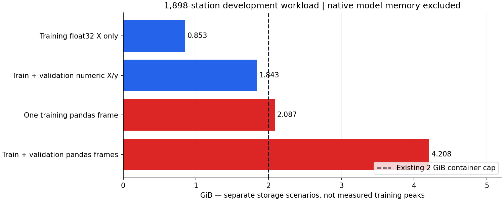

# Full-network ML scaling preparation ? October 29, 2026

**Development-data preparation is ready; full-network training is not enabled or proven under the existing 2 GiB limit.** This work used 2024/2025 only. No new model was trained or scored, no calibration was fitted, no 2026 outcomes were inspected for tuning, and no production/frozen artifact was modified.

**Native integration follow-up:** [smoke and 96-station native capacity validation](NATIVE_CAPACITY.md) now connects disk matrices to native binary datasets and fixed-round fitting. It supports a controlled 192 capacity-test recommendation, not whole-network training approval; larger stages remain disabled. The preparation measurements below are preserved as historical data-only results.

## Development population and projected workload

The cached station-month population contains **2,471 observed stations** and **1,898 eligible stations**. **573** lack the complete development history required by the existing eligibility rule. This is a supported-history network, not every current physical NYC station.

Eligibility is unchanged: all 12 months in both 2024 and 2025, at least 8,000 annual hours and 50 positive hours, plus at least 500 hours and 10 positive hours in every season. All 573 excluded stations lack one or more months; overlapping counts are 463 below annual hours, 243 below annual positives, 399 below seasonal hours, and 401 below seasonal positives. No error- or holdout-based station exclusion is introduced.

| Eligible-network data | Rows |
|---|---:|
| Raw 2024 observations | 16,672,032 |
| Complete-feature 2024 training rows | 16,353,168 |
| Raw / complete-feature 2025 validation rows | 16,626,480 |
| Combined feature rows | 32,979,648 |
| Annual + station-season guard checks | 9,490 |

These feature volumes are projections from verified complete calendars: every eligible station has 8,784 training-year hours and 8,760 validation hours; 2024 loses a 168-hour initial warmup, while 2025 retains past-year context. Full-network features were not materialized. The cached population totals reconcile to the saved 2024/2025 annual gates (19,567,940 and 19,252,720 Gold rows respectively). Those gates report unique station hours, zero invalid features and independent gap-oracle agreement. A future run must pin/revalidate the source snapshot rather than treating this cache as permanently current.

## Scalability audit of current code

| Component | Finding and disposition |
|---|---|
| `jobs/ml_train_pipeline.py` / `ml_experiments.py` | Existing one-station classifier with pandas loading and multi-family/HPO workflow. Preserve it; it is not a network trainer and must not be used as one. |
| `tools/bounded_ml_readiness.py` | Collects selected observations and whole train/validation/test frames in memory. Pilot only. |
| `tools/bounded_cohort_ml.py` | Reads source in batches, but opens one Parquet writer per station/year and concatenates training/validation populations. Network-wide, that means about 3,796 simultaneous writers and oversized DataFrames. Existing <=50 pilot cap is preserved. |
| `jobs/year_features.py` | Spark windows already cross month/year boundaries with gap-aware validity; retain this route for externally sorted/sharded feature preparation. Do not collect whole outputs with `toPandas`. |
| `jobs/decision_policies.py::fit_empirical` | Per-station calibration is separable, but the current full-frame implementation repeatedly masks the global array. Partition by station to retain the same quantile/prior semantics without O(stations ? rows) scans. |
| `jobs/station_robustness.py::checks` | Formula is reusable unchanged. Run on one station at a time and concatenate the five diagnostics rather than retaining all network rows/group indices. Keep full station-week evidence. |
| Existing evaluation tools | Whole-cohort frames and repeated station/season masks will become costly. Batch prediction/baselines once, persist outputs, reduce sufficient statistics and evaluate station guards from partitions. No holdout evaluator was run or modified here. |

The numeric `station_code` is not a geographic or categorical embedding. With 1,898 IDs and `max_bin=63`, numerical binning may pool many station codes. That is a future model-quality risk, not a verified defect in a new model: no new model exists. A categorical/identity strategy must be declared and checked on development data before adopting it; this work does not change existing feature semantics. Never apply an old station-code map to new IDs.

## Memory feasibility

A sampled complete-feature pandas row uses approximately **137 bytes** including station/time/target metadata. The following are separate storage scenarios?not measured full-network process peaks:

| Storage scenario | GiB |
|---|---:|
| Training float32 feature matrix only (14 columns) | 0.853 |
| Training + validation float32 features and targets | 1.843 |
| One complete training pandas frame | 2.087 |
| Complete train + validation pandas frames | 4.208 |



One training DataFrame already exceeds 2 GiB, before feature-selection copies, native LightGBM bins/histograms, gradients, calibration arrays, model state or the interpreter. **The current whole-frame training path is blocked network-wide under that cap.** Native training may need several additional GiB; an 8?12 GiB planning envelope for the legacy all-frame approach is an estimate, not a measured requirement and not an authorized increase. No RAM limit was raised.

## Implemented preparation foundations

- `jobs/cohort_selection.py`: exposes uncapped development eligibility and data-only staged cohort planning. The legacy pilot selector still rejects >50 stations. Its selected 48-station cohort matches the existing saved cohort exactly.
- `jobs/scaling.py::station_feature_stream`: consumes one chronologically ordered station stream in <=4,096-row chunks, retaining at most 168 raw rows. It preserves month/year context, rejects duplicates/unordered/mixed identities and restarts warmup after gaps. Zero-demand observations remain observed data rather than being mistaken for missing hours.
- `parquet_feature_batches`: projected, finite-value-checked batches with hard 2024 training / 2025 validation fences. It never concatenates the network.
- `write_development_memmap`: writes float32 features/labels and hashed row-key partitions under a new directory. Row budgets fail closed without silently truncating. Incomplete builds cannot be mistaken for complete manifests. An 8,616-row existing development shard was round-tripped; no model consumed it.
- `MetricAccumulator`: associative MAE/RMSE/WAPE/asymmetric-cost aggregation from already-recorded values. It reproduced all existing 420,480-row 2025 model metrics at 1e-12 relative tolerance; no prediction API was called.
- `DevelopmentArtifactSink`: new-run-only storage; protects input roots; retains full feature matrices, prediction rows, canonical station/time/actual key hashes, model hash and guard evidence. A model run cannot finalize if training/validation predictions are missing, keys differ, guard evidence changes, or source/fit-row/policy/guard provenance hashes are absent. Preparation-only manifests explicitly report no trained model.
- The future <=50-station pilot training tool now saves the **already computed** training forecast vector and a model/policy/full-feature retention manifest. No extra predict call is introduced, and the tool was not executed. Previously frozen runs remain unchanged; missing historical training predictions were not regenerated.

These are data/artifact components, not a completed full-network trainer. The final LightGBM native-dataset adapter, end-to-end station-partitioned calibration/evaluation integration, writer-cache/shard-compaction implementation and resumable trainer need implementation/capacity validation before full-network training.

## Required bounded architecture

1. **Pin and shard:** freeze the source snapshot, development station manifest and code map. Stream projected source into deterministic station-hash buckets (for example 64); cap simultaneously open writers at eight. Use a writer cache with new immutable part files on reopening, or a separately validated Spark/DuckDB external sort. Never append to a closed Parquet file by overwriting it.
2. **Canonical sort:** externally order each bucket by station and UTC hour, with bounded spill. The implemented stream requires ordered input and rejects violations. The benchmark sorts one station's two-year history in memory; it does not prove a global external-sort implementation.
3. **Feature generation:** process stations/buckets sequentially using the 168-row carry. Persist source/code/row keys and complete float32 feature matrices. Compact tiny output fragments into bounded larger files where practical; the proof-of-concept intentionally uses small immutable parts and is not optimized for metadata latency.
4. **Training options:** either construct a disk-backed global LightGBM Dataset with train-only binning and freed raw Python buffers, or separately authorize a deterministic station/season-stratified 2024 row sample covering all eligible stations (planning budget up to one million fit rows). Persist the exact fit-row manifest; keep full-network 2025 evaluation and full 2024 calibration forecasts separate from fit membership.
5. **Do not fake incremental learning:** LightGBM has no equivalent online `partial_fit` for this workflow. Repeated station-batch fits or indiscriminate `init_model` continuation changes the objective/order and can forget earlier stations. No such training is implemented or enabled.
6. **Calibration:** process each station's retained 2024 predictions independently; about 8,616 rows/station fit easily. Merge states deterministically, retaining the current eight-bin/prior contract unless a separately declared development experiment changes it. Mark in-sample versus out-of-fold calibration predictions. Do not silently relabel validation as fitting data.
7. **Evaluation:** prediction batches must persist actual counts, forecast counts, decisions, station/time keys and feature provenance. Compute baselines on exactly the same eligible rows. Reduce aggregate errors while keeping each station's weekly cost data for the unchanged guard formula. Never drop failed/unsupported stations.
8. **Resume and audit:** seal completed data partitions with hashes; incomplete manifests do not authorize training. Future trained booster checkpoints must record source/bins/code/fit-row hashes and iteration state. No checkpoint is overwritten. Resume logic/native dataset capacity is a future gate, not a completed claim.

## Development-only validation and measured benchmarks

All new stress scenarios use 2024/2025 timestamps, existing development records or generic synthetic fixtures. Calendar-sized 24-hour, one-week and four-week inactivity cases were chosen as generic tests; no observed holdout run length or station exception is encoded. Tests verify that zero-demand history remains valid, real gaps lose warmup, and future validation targets cannot change training features.

Fixed-policy tests inspect mathematical action support from generic training probabilities, not performance tuning. The existing 48-station **2024-derived** empirical states contain **15 constant-action calibrators**. The diagnostic flags this structural limitation; it does not change any probability, threshold, membership or fallback.

- Corrected preparation benchmark: **23.908 seconds**, **0.089 GiB** peak charged memory, 165,167,104 peak process RSS bytes, zero OOM/limit events under two CPUs/2 GiB with no extra swap.
- Six benchmark stations were selected by evenly spaced **2024 training-demand ranks**, using 105,264 raw rows and 104,256 feature rows. Chunked features/timestamps matched the whole-history implementation. Every benchmark includes both full development years, month boundaries, DST and the year transition.
- Streamed features plus audit writes: **17,887 rows/second**. Linear reference for the eligible feature workload: **30.7 minutes**. This is a warm-cache six-station reference excluding global source sharding/external sorting; allow substantial IO/small-file overhead, not an SLA.
- Aggregating saved 2025 validation outputs: **0.747 seconds** for 420,480 rows. A linear all-network reference is about **29.5 seconds**, excluding model inference, baselines, output persistence and guard computation.
- Existing 48-station training took 1.760 seconds on 413,568 rows. Multiplying by row count gives **69.6 seconds**. This is arithmetic only, **not a reliable full-network training runtime estimate**: memory feasibility/native dataset construction and nonlinear scaling are unmeasured. No training was performed to validate it.
- First preparation attempt failed a new timestamp-alignment assertion because Parquet timestamps used microseconds and the check assumed nanoseconds. The new checker now normalizes units explicitly; a real Parquet round-trip regression passes. The failed attempt remains in `network-scaling-prep-01`; this was not a defect in the frozen prediction pipeline.
- Regression suite: **159 passed, two skipped, three deselected** (14 dependency warnings). The three real learner-fit tests were deliberately excluded to honor the no-training/no-new-scoring constraint. Remaining ML-lifecycle tests use mocks, not real model fitting. Host-only Airflow/PySpark checks remain skipped.

## Staged scaling plan and gates

`config/network_scaling_plan.yml` is **planning-only**: training, inference and deployment are false. It is not a scheduler that launches the stages below. Data-only manifests for each stage are saved; prospective code maps are explicitly incompatible with existing trained models.

| Future stage | Stations | 2024 feature rows | 2025 rows | Guard comparisons |
|---|---:|---:|---:|---:|
| A | 96 | 827,136 | 840,960 | 480 |
| B | 192 | 1,654,272 | 1,681,920 | 960 |
| C | 384 | 3,308,544 | 3,363,840 | 1,920 |
| Network | 1,898 | 16,353,168 | 16,626,480 | 9,490 |

**Resource gates:** one ML job at a time, two CPU threads, existing 2 GiB cap and zero extra swap; preparation batches <=4,096 rows and <=168 raw carry rows; maximum eight open writers in the future shard stage. Stop at a predeclared 85% memory headroom gate, any OOM/limit event, or <10 GiB host disk reserve; reserve additional space for immutable features/predictions/spill before each stage. Do not raise RAM automatically. These proposed stage limits must be wired into the future trainer; the measured preparation run was protected by its actual hard Docker cap.

**Data gates:** source/profile hashes and 2024/2025 annual integrity evidence reconcile; station eligibility and hour keys reproduce; bounded feature parity passes; role fences reject held-out inputs; native dataset capacity measured on the next small authorized cohort. A full-network model cannot be approved solely because a memory map exists.

**Quality gates:** retain all frozen annual/seasonal thresholds, weekly uncertainty and support rules. Stop on failures; only a separately declared 2025-only fallback procedure may be considered, followed by complete rechecking and the existing no-aggregate-cost-increase budget. Do not remove failed stations, round margins or extrapolate station codes. At 9,490 comparisons, explicitly report that marginal confidence bounds are not simultaneous guarantees; do not weaken them to make the larger cohort pass.

**Artifact gates:** require all 2024 calibration/training predictions, 2025 predictions, full features or approved reproducible feature evidence, actual fit-row membership, model/policy/code/source hashes, sampling seed, station-week diagnostics and per-role row-key parity. The new sink requires full feature retention for a model run. Full-network uncertainty and inactivity/availability tests must be predeclared using development data; later diagnostics must not select new rules.

**Holdout gate:** no held-out scoring is authorized by this preparation. Freeze the complete approved configuration and evaluate only after separate authorization; previously inspected periods cannot become fresh independent validation.

## Deliverables and commands

- Implementation: `jobs/scaling.py`, development-only selector/planner, `tools/prepare_network_scaling.py`, `tools/plan_network_stages.py`, artifact retention in the bounded pilot tool, and new tests.
- New ignored artifacts: `artifacts/network-scaling-prep-02/` with estimates, exclusions, reconciled annual gate evidence, six-station feature partitions, one disk-matrix probe, recorded metric parity, training-policy support audit, memory trace and test XML. No model artifact was produced.
- `stage_plans/96.json`, `192.json`, `384.json`, `all_eligible.json`: pure-data prospective cohorts, not executable model approvals.
- Exact measured feature-engine source was retained by its recorded SHA-256; the delivered implementation/provenance contract is separately snapshotted. See [portable capacity summary](audit/network_scaling.json).

Reproduce data-only preparation in a **new** container/directory (no model calls):

```powershell
docker run --name citibike_network_scaling_prep_03 --network none --cpus=2 --memory=2g --memory-swap=2g --entrypoint python --mount "type=bind,source=$($PWD.Path),target=/opt/airflow" --workdir /opt/airflow -e PYTHONPATH=/opt/airflow -e OMP_NUM_THREADS=2 -e OPENBLAS_NUM_THREADS=2 citibike-airflow-spark-iceberg:3.2.2-python3.11 -u -m tools.prepare_network_scaling --output /opt/airflow/artifacts/network-scaling-prep-03
```

```powershell
.\.venv\Scripts\python.exe -B -m tools.plan_network_stages --output artifacts/network-scaling-prep-03/stage_plans
.\.venv\Scripts\python.exe -B -m tools.report_network_scaling --run artifacts/network-scaling-prep-02
.\.venv\Scripts\python.exe -B -m pytest -q -k "not small_model_families_and_genuine_metrics"
```

**Next step:** review the data/artifact plan, implement the remaining native-dataset and bounded-writer/trainer integration, then separately authorize a small capacity/training stage. Do not run all-network pandas training, large HPO, held-out evaluation or deployment from this preparation.
