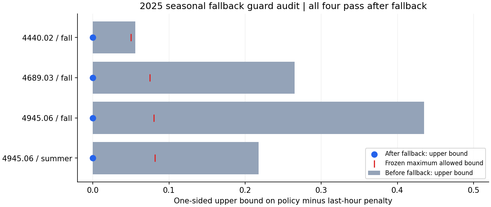

# Seasonal fallback validation ? October 28, 2026

**The existing four-cell last-hour fallback resolves all four failed 2025 guards: 240/240 pass, with no new annual or seasonal failures. Aggregate penalty does not increase.** The 48-station cohort, forecaster, empirical calibrator, target thresholds, guard thresholds and year roles are unchanged. This is validation-only evidence: **no 2026 data was inspected or scored, no model was retrained, and no serving change was made.**

**Later authorized evaluation:** the [single frozen 2026 reused-holdout evaluation](COHORT48_2026.md) is recorded separately, including all failures. This document preserves the earlier 2025-only audit and its original no-2026 scope.

## Audit of the existing implementation

`jobs/station_robustness.py` was reused without modification:

- `guarded_policy(..., seasonal=True)` identifies failed annual/seasonal comparisons using the frozen paired-cost guard. Annual failures go to whole-station fallback; failed seasonal cells go to last-hour actions only in those cells.
- `apply_policy` matches known station IDs and America/New_York seasons. It changes the **class action**, not the count forecast. It can apply the frozen overlay without actual demand labels.
- After partial seasonal replacement, the implementation recomputes all comparisons and can escalate remaining failures to full-station fallback. The actual result here required **no escalation**: `fallback_stations` is empty.
- Identity with baseline actions is an existing permitted guard condition. In a replaced cell the paired action-cost difference is identically zero, so its mean difference, standard error and upper bound are zero. Passing therefore expresses baseline equivalence, not a newly proven learned advantage.
- The existing code correctly handled these cells; no bug fix or guard relaxation was necessary. Added validation code checks unchanged action behavior outside the fallback cells, identity to last-hour actions inside them, forecast immutability, label-independent inference, exact coverage of all 240 comparisons, and a no-aggregate-increase acceptance budget.

## Original failures: regression versus uncertainty

All four cells meet the frozen minimum-support rules. `4945.06` fall had a worse observed mean than baseline (+0.1304 cost units/hour); the other three had better observed means but an upper bound above tolerance. A point regression is not proof of population-level harm, and a better mean is not enough to pass the uncertainty requirement.

The guard retains the original one-sided 95% weekly-cluster Student-t bound on policy-minus-last-hour cost, maximum bound `max(0.05, 2% of baseline mean penalty)`, annual support of 2,000 hours/26 week blocks/50 positive hours, and seasonal support of 500 hours/eight week blocks/10 positive hours. The cost matrix and training-only q25/q75 actual classes are unchanged.

| Station / season | Hours / weeks | Before penalty | After = last-hour penalty | Before upper bound | After upper bound | Frozen allowed bound |
|---|---:|---:|---:|---:|---:|---:|
| 4440.02 / fall | 2,185 / 13 | 1.638444 | 1.693364 | 0.055928 | 0.000000 | 0.050000 |
| 4689.03 / fall | 2,185 / 13 | 3.720824 | 3.752860 | 0.265201 | 0.000000 | 0.075057 |
| 4945.06 / fall | 2,185 / 13 | 4.146453 | 4.016018 | 0.435237 | 0.000000 | 0.080320 |
| 4945.06 / summer | 2,208 / 14 | 4.035326 | 4.076087 | 0.217649 | 0.000000 | 0.081522 |



## Rechecking all 240 comparisons

| Scope | Before | After | New failures |
|---|---:|---:|---:|
| Annual station guards | 48/48 pass | 48/48 pass | 0 |
| Station-season guards | 188/192 pass | 192/192 pass | 0 |
| Total | 236/240 pass | **240/240 pass** | **0** |

All 236 previously passing comparisons still pass. The 45 unaffected annual comparisons and 188 untouched seasonal comparisons retain their actions; the three affected annual comparisons were recomputed, not assumed safe.

| Affected station | Annual penalty before | Annual penalty after | Last-hour annual penalty | Annual upper bound before | Annual upper bound after | Allowed bound |
|---|---:|---:|---:|---:|---:|---:|
| 4440.02 | 1.478311 | 1.492009 | 1.658105 | -0.125648 | -0.115949 | 0.050000 |
| 4689.03 | 2.629566 | 2.637557 | 2.908105 | -0.177990 | -0.194588 | 0.058162 |
| 4945.06 | 2.787671 | 2.765411 | 3.019406 | -0.108409 | -0.178143 | 0.060388 |

Every comparison, including mean differences, before/after upper bounds, sample counts, unchanged tolerance and pass/fail outcome, is retained in **`artifacts/cohort-48-fallback-01/all_240_guard_changes.csv`** and the portable [all-240 audit summary](audit/seasonal_fallback.json). `remaining_failures.json` is an empty list.

## Aggregate effect and forecast integrity

Acceptance required **all 240 guards passing and no increase in aggregate validation cost**. This adds an aggregate budget without weakening any existing station/season rule.

| Validation metric | Before | After |
|---|---:|---:|
| Total operational penalty | 895,530 | 895,525 |
| Mean operational penalty | 2.129780251 | 2.129768360 |
| Count MAE | 1.339471837 | 1.339471837 |
| Count RMSE | 2.502124724 | 2.502124724 |
| Count WAPE | 51.488571% | 51.488571% |

The five-unit total reduction is **effectively no aggregate cost change**, not a material model-performance gain. Switching to baseline increases the cell totals by 120 units at `4440.02` fall, 70 at `4689.03` fall, and 90 at `4945.06` summer, while reducing `4945.06` fall by 285. The asymmetric totals nearly cancel.

The overlay covers **8,763 of 420,480 validation hours** (about 2.08%), and actually changes **1,830** class actions. Predictions and global empirical probabilities remain untouched; no count forecasts are replaced by lag counts.

Secondary decision metrics do not all improve: class accuracy changes from **83.5096% to 83.4492%**, and the High-action rate on actual zero-demand hours rises from **1.8800% to 2.0346%**. These are tradeoffs of baseline-equivalent action guards under the specified asymmetric objective, not concealed forecast changes.

## Strict 2025-only execution and preservation

The run reads the existing **420,480-row 2025 validation predictions/actions**, its 2024-derived target thresholds and the frozen empirical calibration. It does not read source Gold rows, load the fitted model for inference, train/recalibrate anything, or inspect any 2026 predictions or scores. All timestamps were verified as 2025 in New York time. Original global actions and last-hour actions were independently reconstructed and all 240 original guard records matched exactly before the fallback audit.

Artifacts are written into a new directory only. The original 48-station experiment's complete file hashes, including the native/Joblib model, empirical policy, cohort, raw/engineered data and metrics, were checked unchanged. The immutable source thresholds and constraints were reused. Production serving and original datasets/checkpoints are unchanged; no commit or push occurred.

Runtime was **18.226 seconds**, excluding container startup/imports and later plots/tests. Peak charged container memory was **389,144,576 bytes (0.362 GiB)** under a 2 GiB cap; two CPUs, no additional swap, zero memory-limit/OOM/OOM-kill events. Process peak RSS was 474,791,936 bytes. These are experiment-container values, not total Docker-stack memory.

Automated regression suite: **145 passed, two skipped**, with 17 dependency warnings. Added acceptance tests prevent aggregate improvement from hiding an unresolved guard, reject missing/duplicated comparisons, and enforce the no-increase aggregate budget. Existing fallback tests cover seasonal locality, whole-station fallback, paired uncertainty, support requirements and inference without true labels. The two host-only Airflow/PySpark checks remain skipped.

## Frozen overlay, audit files and reproduction

New local ignored directory: **`artifacts/cohort-48-fallback-01/`**. It contains:

- `validation_overlay_lock.json`: four fixed station-season overrides, unchanged constraints and source model/policy hashes. It is validation-only and explicitly does not authorize deployment.
- `all_240_guard_changes.csv`, complete before/after guard JSON, affected/unaffected station metrics, empty remaining-failure list, validation decisions and unchanged counts.
- Acceptance plan, aggregate metrics, source/input hash manifests, memory/progress logs, source snapshots and regression XML.

Use a new container/output directory to reproduce without overwriting saved evidence:

```powershell
docker run --name citibike_seasonal_fallback_02 --network none --cpus=2 --memory=2g --memory-swap=2g --entrypoint python --mount "type=bind,source=$($PWD.Path),target=/opt/airflow" --workdir /opt/airflow -e PYTHONPATH=/opt/airflow -e OMP_NUM_THREADS=2 -e OPENBLAS_NUM_THREADS=2 citibike-airflow-spark-iceberg:3.2.2-python3.11 -u -m tools.validate_seasonal_fallback --output /opt/airflow/artifacts/cohort-48-fallback-02
```

Regenerate presentation or run regression checks without rerunning model training:

```powershell
.\.venv\Scripts\python.exe -m tools.report_seasonal_fallback
.\.venv\Scripts\python.exe -m pytest -q
```

## Conclusion and limitations

The existing seasonal fallback is acceptable **on 2025 validation under the frozen guards and the stricter zero aggregate-increase budget**. It requires exactly the four requested cells and no annual escalation. These comparisons use the same validation data that identify fallback membership; passing is not an independent generalization guarantee, and baseline identity is not a learned improvement. The existing weekly uncertainty method also does not provide multiplicity-adjusted simultaneous coverage.

The original global empirical policy and stopped 48-station artifacts remain unchanged; the fallback is a separate frozen overlay. There are **no remaining validation guard failures**, but no 2026 diagnostic evidence for this overlay and no production approval. No further evaluation or deployment was performed.
