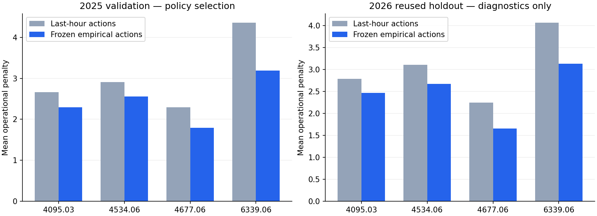

# Station-level robustness validation ? October 28, 2026

**Decision: retain the global empirical policy for this pilot, without shrinkage or activated fallback. It is ready for a controlled larger-cohort experiment using the same validation procedure, not unrestricted serving or unseen-station extrapolation.** All 60 prespecified 2025 station/season checks passed. Production serving and all existing model/data artifacts remain unchanged.

2026 is reported only as **reused-holdout diagnostics**. It was previously inspected in earlier experiments. Neither the four previously flagged stations nor new diagnostic findings were used to tailor constraints, select shrinkage, or change fallback membership.

**Larger-cohort follow-up:** the [48-station experiment](COHORT48.md) is resource-feasible but stopped at four seasonal guard failures. The 12-station results here remain valid for their original cohort; they did not certify larger-cohort robustness.

## What the four regressions mean

The earlier four small regressions were versus the **original continuous-mean-to-class conversion**, not versus last-hour actions. The operational reference here is last-hour actions, applied to the same frozen actual-class thresholds. These are not four failures against that baseline.

Each of the four stations has **8,616 complete-feature training hours**, **8,760 validation hours**, and **6,551 January?September diagnostic hours**. Training excludes the initial 168-hour warmup; validation retains cross-year lag context. None has the q25=q75=0 degeneracy responsible for the original severe sparse-station problem.

| Station | Zero hours: 2024 / 2025 / reused 2026 | Positive hours: 2025 / reused 2026 | 2025 empirical / last-hour penalty | Reused 2026 empirical / last-hour penalty |
|---|---|---:|---:|---:|
| 4095.03 | 39.17% / 36.24% / 36.99% | 5,585 / 4,128 | 2.2894 / 2.6627 | 2.4691 / 2.7858 |
| 4534.06 | 42.15% / 39.11% / 38.51% | 5,334 / 4,028 | 2.5548 / 2.9110 | 2.6713 / 3.1049 |
| 4677.06 | 27.36% / 25.80% / 27.26% | 6,500 / 4,765 | 1.7911 / 2.2974 | 1.6578 / 2.2439 |
| 6339.06 | 21.79% / 14.05% / 14.59% | 7,529 / 5,595 | 3.1901 / 4.3607 | 3.1255 / 4.0666 |

### Seasonal demand and sample support

In 2025, winter has 2,160 hours, spring 2,207, summer 2,208 and fall 2,185 per station; DST is handled in elapsed UTC hours and seasons use New York dates. All four stations have higher winter sparsity and lower winter mean demand. All four beat last-hour actions in **every validation season**.

| Station | Winter / summer zero fraction | Winter / summer mean rides | Validation seasonal penalty difference range vs last-hour |
|---|---:|---:|
| 4095.03 | 51.57% / 26.18% | 0.967 / 2.811 | -0.4256 to -0.2831 |
| 4534.06 | 59.03% / 25.32% | 0.629 / 2.047 | -0.4597 to -0.2616 |
| 4677.06 | 32.73% / 21.47% | 2.994 / 5.933 | -0.6567 to -0.3102 |
| 6339.06 | 22.18% / 9.24% | 4.950 / 9.322 | -1.5444 to -0.6134 |



### Why the reused-holdout conversion regressions occurred

This decomposition uses already-saved diagnostic actions and does not refit or reselect anything. Empirical action changes trade overprediction against more expensive underprediction. More helped hours do not guarantee lower cost when a harmed tier costs 15 and a helped tier saves 10.

| Station | Changed actions / 6,551 hours | Helped / harmed hours | Underprediction cost change | Overprediction cost change | Net cost change vs original mapping |
|---|---:|---:|---:|---:|
| 4095.03 | 509 | 298 / 211 | +3,165 | -2,980 | +185 (+0.0282/hour) |
| 4534.06 | 743 | 433 / 310 | +4,650 | -4,330 | +320 (+0.0488/hour) |
| 4677.06 | 51 | 30 / 21 | +315 | -300 | +15 (+0.0023/hour) |
| 6339.06 | 424 | 166 / 258 | -2,460 | +2,560 | +100 (+0.0153/hour) |

At `4095.03`, `4534.06` and `4677.06`, lower overprediction cost was slightly outweighed by higher underprediction cost. At `6339.06`, the direction reversed. These small realized tradeoffs do not show cost-matrix corruption or a lag bug. They remain real regressions versus the original mapping and are not hidden by the baseline comparison.

Reused seasonal deltas versus the original mapping are largest in summer for `4095.03` (+0.1313), September-only fall for `4534.06` (+0.3125), September for `4677.06` (+0.0278), and spring for `6339.06` (+0.0838). Nevertheless, all four retain lower point-estimate cost than last-hour actions in each observed diagnostic season. The January?September mix is not directly interchangeable with a full calendar year.

## Constraints fixed before validation evaluation

`prespecified_plan.json` was written before the 2024/2025 data scan. The same rules apply to **all 12 stations**; none was fitted to a 2026 failure. The class thresholds, cost matrix, empirical probability bins and count forecaster are unchanged.

For each station and each station-season cell:

1. Compute paired hourly cost difference **policy minus last-hour actions**, preserving shared outcomes/timestamps. Lower is better.
2. Use New York calendar-week clusters to account for within-week dependence. The cluster-robust standard error of the hourly mean uses weighted residual weekly totals, with a one-sided 95% Student-t upper bound (degrees of freedom = week blocks ? 1). This is not an IID-hour calculation.
3. Require upper bound ? **max(0.05 cost units/hour, 2% of baseline mean cost)**. The 0.05 floor avoids rejecting negligible changes at nearly zero-cost stations; 2% caps relative degradation at busier stations. These are engineering tolerances chosen before validation, not thresholds optimized for the four diagnostic regressions.
4. Require at least **2,000 hours, 26 week blocks and 50 positive-demand hours annually**, and **500 hours, eight week blocks and 10 positive hours per season**. Exact identity with baseline actions is accepted because it has zero incremental action risk; it is not claimed as evidence of a learned benefit.
5. A learned cell lacking support cannot claim non-inferiority. Whole-station fallback uses last-hour actions if any validation annual/season check fails. Seasonal fallback replaces failed cells, with full-station escalation if the partial fallback creates an annual failure. Membership is determined on 2025 and frozen.

These are conservative operational screening rules, not simultaneous 95% confidence guarantees: no multiplicity correction is applied, validation is used for policy selection, adjacent weeks can still be dependent, and no new independent holdout is available. They do not establish real financial impact or inventory feasibility.

## Validation-only policy selection

The empirical probabilities were already fitted on 2024. Five mixtures were compared: `(1?alpha) ? empirical class probabilities + alpha ? one-hot last-hour action`, followed by expected-cost minimization, for alpha 0/0.25/0.5/0.75/1. The last-hour influence acts only on decisions; no count prediction is blended or replaced. Whole-station and seasonal guarded policies were also evaluated.

| Candidate | 2025 mean penalty | Validation checks passed | Reused 2026 mean penalty |
|---|---:|---:|---:|
| global_shrink_0 | 2.1903 | 60/60 | 2.0742 |
| global_shrink_0.25 | 2.4058 | 60/60 | 2.2612 |
| global_shrink_0.5 | 2.6476 | 60/60 | 2.4973 |
| global_shrink_0.75 | 2.7074 | 60/60 | 2.5614 |
| global_shrink_1 | 2.7074 | 60/60 | 2.5614 |
| guarded_station | 2.1903 | 60/60 | 2.0742 |
| guarded_seasonal | 2.1903 | 60/60 | 2.0742 |

**Frozen winner: `global_shrink_0`**, the original empirical expected-cost policy. It has the lowest validation cost among candidates passing every guard. The guarded variants identify no fallback station/cell and are action-identical to the global policy; no extra fallback complexity is warranted here. Mixing in the baseline increases cost. At alpha 0.75 and 1, decisions coincide with the baseline.

All **12 annual + 48 seasonal validation checks pass**. Every empirical upper bound is actually below zero, not merely within the allowed positive tolerance; the least-negative bound is approximately ?0.0733 (`SYS033`, spring). The policy/constraints were frozen before opening 2026 predictions.

## Reused-holdout diagnostics, kept separate

- No policy, threshold, mixture weight or fallback was changed from these results.
- All 12 annual station checks pass. Of 36 adequately supported winter/spring/summer station-season cells, **35 pass**.
- `6316.05` summer has 2,208 hours and 14 week blocks. Its empirical point penalty **2.6427** is below baseline **2.6834**, but the paired upper bound **+0.1950** exceeds tolerance **0.0537**. Thus non-inferiority is **inconclusive** under the frozen rule despite a better mean. This station was not one of the four earlier conversion regressions.
- All 12 fall cells contain September only: 720 hours and five week blocks. They do not meet the eight-block seasonal support requirement, so they remain **unsupported**, not passed or silently pooled into a full-season claim. No October?December records were added.
- Aggregate reused penalty remains **2.0742**, versus original conversion **4.0003** and last-hour actions **2.5614**. These descriptive results are not fresh independent validation.

## Forecast integrity, resources and tests

Count predictions are bit-identical to the earlier artifacts: **MAE 1.4465, RMSE 2.9773, WAPE 43.26%** on the reused period. Action-baseline rows in this run retain the LightGBM forecast for count-metric comparison; they do not substitute lag-count forecasts. Original count-baseline accuracy remains documented in [ML readiness](ML_READINESS.md).

The bounded run took **25.838 seconds**, including data extraction/features, validation guard construction and diagnostic reporting. Candidate evaluation/ranking took **6.541 seconds**; this is not pure action latency. Peak charged cgroup memory was **1,379,758,080 bytes (1.285 GiB)** under the 2 GiB cap, with two CPUs, no extra swap and zero limit/OOM/OOM-kill events. Peak process RSS was 1,474,678,784 bytes. Memory figures cover the experiment container, not the entire Docker stack.

**138 tests passed, two skipped**, with 17 dependency warnings. New regressions cover shrinkage endpoints, probability immutability, paired weekly guards, insufficient support, whole-station/seasonal fallback, label-independent inference, and local season/week boundaries across DST. Host-only Airflow/PySpark checks remain skipped; the real Docker run exited successfully.

## Artifacts and reproduction

Git-ignored outputs: `artifacts/station-robustness-01/`. The directory contains the prespecified constraints, frozen selection and empirical policy, all candidate metrics/checks, station/season demand profiles, paired bounds, action-change decomposition, CSV exports, diagnostic action vectors, source snapshots/hashes, memory samples and regression XML. See the portable [summary](audit/station_robustness.json). Prior experiments and all 33 ingestion checkpoints passed input-hash preservation checks. Production models and source tables were not written; no count model or probability calibrator was refitted.

From the repository root, use a new output/container name; existing run directories cannot be overwritten:

```powershell
docker run --name citibike_station_robustness_02 --network none --cpus=2 --memory=2g --memory-swap=2g --entrypoint python --mount "type=bind,source=$($PWD.Path),target=/opt/airflow" --workdir /opt/airflow -e PYTHONPATH=/opt/airflow -e OMP_NUM_THREADS=2 -e OPENBLAS_NUM_THREADS=2 citibike-airflow-spark-iceberg:3.2.2-python3.11 -u -m tools.bounded_station_robustness --output /opt/airflow/artifacts/station-robustness-02
```

Presentation-only regeneration and tests:

```powershell
.\.venv\Scripts\python.exe -m tools.report_station_robustness
.\.venv\Scripts\python.exe -m pytest -q
```

## Readiness for a larger cohort

**Yes for a bounded larger-cohort experiment with frozen validation guards; no for unrestricted production rollout.** Keep the current global policy for these 12 stations. Reuse the prespecified constraint procedure rather than hard-coding exceptions from 2026. Retain the supported summer uncertainty flag and lack of full-fall diagnostic coverage in the audit trail.

New station IDs are not safely supported by the present 12-station forecaster code map or station-specific empirical bins. A larger ML cohort needs 2024-only station selection and appropriate training/calibration coverage, or a clearly separated baseline-only route for unsupported stations. Never invent a station code or silently extrapolate its probabilities. Verify the expanded cohort on 2025 under the same memory ceiling before allowing broader optimization. Use genuinely new/independently governed data for stronger generalization claims; repeatedly examining 2026 cannot create a fresh holdout.
